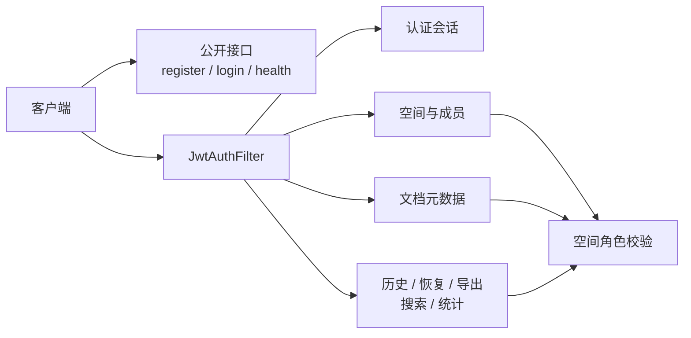

# REST API 参考

本文按 2026-10-22 实现同步 Spring Boot 服务的 REST 契约。默认基址为 `http://localhost:8080`；除公开接口外，所有请求都要携带 Bearer JWT，JSON 请求同时设置对应 Content-Type：

```http
Authorization: Bearer <JWT>
Content-Type: application/json
```

相关文档：[系统架构](architecture.md) · [数据库设计](database-er.md) · [WebSocket 协议](websocket-protocol.md) · [部署说明](deployment.md)

## 1. 接口总览



| 方法 | 路径 | 认证 | 用途 |
|---|---|---:|---|
| `POST` | `/api/auth/register` | 否 | 注册并签发 token |
| `POST` | `/api/auth/login` | 否 | 登录并签发 token |
| `GET` | `/api/auth/me` | 是 | 当前用户 |
| `PUT` | `/api/auth/me` | 是 | 修改当前用户昵称 |
| `PUT` | `/api/auth/me/avatar` | 是 | 上传当前用户头像（multipart `file`） |
| `DELETE` | `/api/auth/me/avatar` | 是 | 恢复默认头像 |
| `GET` | `/api/users/{uid}/avatar` | 是 | 读取用户头像，无头像返回 404 |
| `POST` | `/api/auth/refresh` | 是 | 换发 token |
| `GET` | `/api/health` | 否 | 应用健康信息 |
| `GET` | `/api/spaces` | 是 | 我的空间 |
| `POST` | `/api/spaces` | 是 | 创建空间 |
| `GET` | `/api/spaces/{id}/members` | 是 | 成员列表 |
| `POST` | `/api/spaces/{id}/members` | 是 | 邀请成员或调整角色 |
| `PUT` | `/api/spaces/{id}/members/{userId}` | 是 | 调整已有成员的 editor/viewer 权限 |
| `DELETE` | `/api/spaces/{id}/members/{userId}` | 是 | 将成员移出空间 |
| `GET` | `/api/spaces/{spaceId}/trash` | 是 | 当前空间回收站，仅 owner/admin |
| `GET` | `/api/docs` | 是 | 可见文档列表 |
| `POST` | `/api/docs` | 是 | 创建文档/白板/看板 |
| `GET` | `/api/docs/{docKey}` | 是 | 文档元数据 |
| `PUT` | `/api/docs/{docKey}` | 是 | 修改标题 |
| `DELETE` | `/api/docs/{docKey}` | 是 | 软删除文档 |
| `POST` | `/api/docs/{docKey}/restore-deleted` | 是 | 从回收站恢复原内容，仅 owner/admin |
| `GET` | `/api/docs/{docKey}/history` | 是 | 操作时间线 |
| `GET` | `/api/docs/{docKey}/replay` | 是 | 指定版本回放 |
| `POST` | `/api/docs/{docKey}/restore` | 是 | 恢复到指定版本 |
| `GET` | `/api/docs/{docKey}/export?format=...` | 是 | 按内容类型导出 |
| `POST` | `/api/docs/{docKey}/images` | 是 | 图片上传（owner/editor） |
| `GET` | `/api/assets/{assetId}` | 是 | 空间权限保护的图片读取 |
| `GET` | `/api/docs/search` | 是 | 标题/正文检索 |
| `GET` | `/api/stats` | 是 | 当前用户可见范围统计 |

## 2. 通用约定

### 2.1 命名与时间

控制器手工构造的响应通常使用 camelCase，例如 `docKey`、`spaceId`；JDBC 查询直接返回的行使用数据库 snake_case，例如 `doc_key`、`space_id`、`my_role`、`created_at`。客户端不得假设两者会自动统一。

MySQL `DATETIME` 经 JDBC/Jackson 输出的具体文本格式由运行时序列化决定；客户端应把时间字段当作时间值解析，不依赖固定小数位。健康检查的 `time` 为 ISO-8601 字符串。

### 2.2 用户对象

```json
{
  "id": 12,
  "username": "owner_demo",
  "nickname": "演示所有者",
  "role": "editor",
  "avatarUrl": "/api/users/12/avatar?v=<version>"
}
```

这里的 `user.role` 是平台账号字段；某个空间内的权限必须读取 `space_member.role`，即接口中的 `my_role` 或成员列表 `role`。

`PUT /api/auth/me` 接收 `{ "nickname": "新昵称" }`，去除首尾空格后需为 1–32 字，不允许控制字符；不修改登录用户名或角色。上传头像需使用 `multipart/form-data` 的 `file` 字段，仅接受真实 PNG/JPEG，最大 2MB、边长不超过 4096px、总像素不超过 1600 万；服务端裁剪并重新编码为 256×256 PNG。修改接口返回 `{ "user": {...}, "msg": "..." }`；`avatarUrl` 为空字符串代表默认头像，读取头像需携带 Bearer JWT。昵称和头像保存在 MySQL，空间成员列表也返回 `avatar_url`。

### 2.3 错误响应

业务错误通常返回：

```json
{ "msg": "错误说明" }
```

| HTTP 状态 | 含义 | 常见场景 |
|---:|---|---|
| `400` | 请求不合法 | 字段格式、长度、`kind`、`rev` 或查询参数错误 |
| `401` | 未认证 | 缺少/无效/过期 Bearer JWT，登录凭据错误 |
| `403` | 已认证但无权限 | 非空间成员、viewer 尝试写入、非 owner 管理成员或删除 |
| `404` | 目标不存在或不可见 | 文档读取/更新/删除不存在；回收站隐藏非成员空间或内容；邀请用户或要管理的成员不存在 |
| `409` | 状态冲突 | 注册用户名已存在、导出引用资源缺失、回收站恢复时内容状态变化 |
| `413` | 请求体过大 | 图片上传超过 multipart 限制 |
| `503` | 数据库暂不可用 | Spring `DataAccessException` 被统一映射 |

所有 `/api/**` 响应均设置 `Cache-Control: no-store`。认证过滤器还设置 `X-Content-Type-Options: nosniff`、`X-Frame-Options: DENY` 与 `Referrer-Policy: same-origin`。

## 3. 权限矩阵

旧数据角色 `admin` 仅作为兼容值，权限等同 `owner`；新空间使用 `owner`。

| 操作 | `owner` | `editor` | `viewer` |
|---|:---:|:---:|:---:|
| 查看空间、成员和内容 | 是 | 是 | 是 |
| 查看历史、回放、导出、搜索、统计 | 是 | 是 | 是 |
| 创建内容、改标题、WebSocket 编辑 | 是 | 是 | 否 |
| 恢复历史版本 | 是 | 是 | 否 |
| 邀请、移除成员/调整 `editor`、`viewer` | 是 | 否 | 否 |
| 删除文档/白板/看板 | 是 | 否 | 否 |
| 查看空间回收站、恢复软删除内容 | 是 | 否 | 否 |
| 修改或移除空间所有者 | 否 | 否 | 否 |

## 4. 认证接口

### 4.1 注册

`POST /api/auth/register`

请求：

```json
{
  "username": "owner_demo",
  "password": "demo-pass-123",
  "nickname": "演示所有者"
}
```

约束：`username` 为 3–32 位字母、数字、下划线或连字符；密码至少 6 位且 UTF-8 编码不超过 **72 字节**，汉字通常占 3 字节，不能按 72 个汉字理解；昵称可省略，最长 32 字且不能含控制字符。注册成功时同时创建“我的空间”，注册者为该空间 `owner`。

成功 `200`：

```json
{
  "token": "<JWT>",
  "user": {
    "id": 12,
    "username": "owner_demo",
    "nickname": "演示所有者",
    "role": "editor"
  },
  "msg": "注册成功"
}
```

错误：格式问题 `400`；用户名已存在 `409`。

### 4.2 登录

`POST /api/auth/login`

```json
{ "username": "owner_demo", "password": "demo-pass-123" }
```

成功 `200`：`{ "token": "<JWT>" }`。用户名或密码错误返回 `401`，不会区分账号不存在与密码错误。超过 72 个 UTF-8 字节的候选密码也被拒绝，避免 BCrypt 忽略超长后缀。旧版本曾接受的超长密码没有在本次更新中自动迁移。

### 4.3 当前用户

`GET /api/auth/me`

成功 `200`：

```json
{
  "user": {
    "id": 12,
    "username": "owner_demo",
    "nickname": "演示所有者",
    "role": "editor"
  },
  "msg": "ok"
}
```

用户信息实时查库，不只信任 JWT 载荷。账号已不存在或 token 无效时返回 `401`。

### 4.4 刷新 token

`POST /api/auth/refresh`

请求体可省略。成功 `200`：

```json
{
  "token": "<new JWT>",
  "user": {
    "id": 12,
    "username": "owner_demo",
    "nickname": "演示所有者",
    "role": "editor"
  }
}
```

旧 token 不会被服务端主动加入黑名单，将在自身到期后失效。

Vue 客户端会同步同一浏览器其他标签页中的退出/账号切换，并卸载旧账号编辑会话；同一 `uid/sub` 的正常 token 换发保留当前页面。此为客户端会话隔离行为，不表示服务端撤销了旧 token。头像二进制读取与其他 API 共用 token 刷新流程；个人资料修改暂不向其他标签页即时推送。

## 5. 健康检查

`GET /api/health`

```json
{
  "status": "UP",
  "engine": "<engine id>",
  "time": "2026-09-20T10:30:00+08:00"
}
```

此接口表示 Spring 应用已响应，不等同于完整的数据库读写和 WebSocket 端到端检查。

## 6. 空间接口

### 6.1 我的空间

`GET /api/spaces`

成功 `200`，返回数组：

```json
[
  {
    "id": 3,
    "name": "毕业设计演示",
    "owner_id": 12,
    "my_role": "owner",
    "doc_count": 3,
    "member_count": 3
  }
]
```

`doc_count` 只统计未软删除内容。

### 6.2 创建空间

`POST /api/spaces`

```json
{ "name": "毕业设计演示" }
```

空间名去除首尾空白后长度为 1–128，不能含控制字符。成功 `200`：

```json
{ "spaceId": 3, "name": "毕业设计演示", "msg": "创建成功" }
```

创建者自动成为 `owner`。

### 6.3 成员列表

`GET /api/spaces/{id}/members`

调用者必须是该空间成员。成功 `200`：

```json
{
  "members": [
    { "id": 12, "username": "owner_demo", "nickname": "演示所有者", "role": "owner" },
    { "id": 13, "username": "editor_demo", "nickname": "演示编辑者", "role": "editor" }
  ]
}
```

### 6.4 邀请或调整角色

`POST /api/spaces/{id}/members`

仅 `owner`/兼容 `admin` 可调用：

```json
{ "username": "viewer_demo", "role": "viewer" }
```

`role` 只允许 `editor` 或 `viewer`。目标用户必须已注册；对已有成员执行 upsert，相当于调整角色。不能通过此接口修改空间所有者。

成功 `200`：`{ "msg": "已邀请 viewer_demo", "role": "viewer" }`。

### 6.5 调整成员权限

`PUT /api/spaces/{id}/members/{userId}`

仅空间 `owner`/兼容 `admin` 可调用；目标必须是已有普通成员：

```json
{ "role": "viewer" }
```

`role` 必须精确为 `editor` 或 `viewer`，不可为 null。成功 `200`：

```json
{ "userId": 13, "role": "viewer", "msg": "成员权限已更新" }
```

空间或成员 ID 非正整数、角色非法、尝试更改所有者返回 `400`；无管理权限返回 `403`；目标成员已不存在返回 `404`。更新后即时刷新服务端权限缓存与该成员在空间内的全部在线连接，通过 WebSocket `access` 帧更新编辑能力；已经排队但尚未提交的操作仍需通过提交时权限检查。重新邀请已有成员也采用同样的实时刷新行为。

### 6.6 移除成员

`DELETE /api/spaces/{id}/members/{userId}`

仅空间所有者可调用，不能移除所有者。成功 `200`：

```json
{ "userId": 13, "removed": true, "msg": "成员已移出空间" }
```

被移除成员不能再访问该空间内容、图片和历史，其全部相关在线连接收到 fatal `MEMBERSHIP_REVOKED` 后关闭。移除不删除账号，也不删除该成员曾创建的内容。非法 ID/所有者目标返回 `400`，无管理权限返回 `403`，目标已不在空间返回 `404`。

### 6.7 空间回收站

`GET /api/spaces/{spaceId}/trash`

仅该空间 `owner`/兼容 `admin` 可查看。成功 `200`：

```json
{
  "documents": [
    {
      "doc_key": "550e8400-e29b-41d4-a716-446655440000",
      "title": "项目说明",
      "kind": "doc",
      "space_id": 3,
      "space_name": "毕业设计演示",
      "deleted_at": "<datetime>",
      "updated_at": "<datetime>",
      "my_role": "owner"
    }
  ]
}
```

只返回指定空间中 `deleted_at IS NOT NULL` 的内容，按删除时间倒序、同时间按内容键排序；空回收站返回 `{ "documents": [] }`。未登录 `401`，非法空间 ID `400`；同空间 editor/viewer `403`；非成员和不存在空间均返回空 `404`，不泄露其他空间是否存在。未提供永久删除或自动清空接口。

## 7. 文档元数据接口

本文中的“文档”是三类内容的统称。

### 7.1 列表

`GET /api/docs?spaceId={id}&kind={kind}`

两个查询参数均可省略。`kind` 只允许 `doc`、`board`、`kanban`；指定 `spaceId` 时须为正整数，调用者须为该空间成员。成功 `200`：

```json
[
  {
    "doc_key": "550e8400-e29b-41d4-a716-446655440000",
    "title": "项目说明",
    "kind": "doc",
    "created_at": "<datetime>",
    "updated_at": "<datetime>",
    "space_id": 3,
    "space_name": "毕业设计演示",
    "my_role": "owner"
  }
]
```

未指定空间时仅返回调用者已加入空间中的有效内容。结果按 `updated_at` 倒序；正文、白板、看板的持久化编辑会在日志同一事务中更新时间，重复操作确认和失败写入不改变该时间。

### 7.2 创建

`POST /api/docs`

```json
{ "title": "项目说明", "kind": "doc", "spaceId": 3 }
```

- `kind` 可省略，默认 `doc`，显式 null 或其他值返回 `400`；
- `title` 可空，服务端按类型生成“未命名文档/白板/看板”，非空时最长 256 字；
- `spaceId` 可省略，服务端使用可见空间列表的第一项（当前按空间 ID 倒序）；显式 null、空白、非整数或非正数返回 `400`，不会静默改建到另一个空间；
- 调用者必须在目标空间有写权限。

成功 `200`：

```json
{
  "docKey": "550e8400-e29b-41d4-a716-446655440000",
  "title": "项目说明",
  "kind": "doc",
  "spaceId": 3
}
```

首次创建文档（`doc`）对应 `CollabRoom` 时，服务端会播种根元素与首个文本段落；白板、看板房间初始为空。这属于协同状态，不在本响应中返回。

### 7.3 读取元数据

`GET /api/docs/{docKey}`

成功 `200`：

```json
{
  "doc_key": "550e8400-e29b-41d4-a716-446655440000",
  "title": "项目说明",
  "kind": "doc",
  "created_by": 12,
  "created_at": "<datetime>",
  "updated_at": "<datetime>",
  "space_id": 3,
  "space_name": "毕业设计演示",
  "my_role": "owner"
}
```

### 7.4 修改标题

`PUT /api/docs/{docKey}`

```json
{ "title": "项目说明（终稿）" }
```

标题去除首尾空白后长度为 1–256，不能包含控制字符或为 null。`owner`、`editor` 可调用。成功 `200`：

```json
{ "docKey": "550e8400-e29b-41d4-a716-446655440000", "title": "项目说明（终稿）" }
```

成功改名后向在线连接广播 WebSocket `metadata {docId, kind, title}`；新连接和重连也携带最新标题。文档保留兼容的 DOC.title 投影，白板和看板改名不会新增 DOC 元素或正文日志。改名是 REST 能力，WebSocket `DOC.title` 写入会被拒绝。

### 7.5 软删除

`DELETE /api/docs/{docKey}`

仅空间 `owner` 可调用。成功 `200`：`{ "deleted": true }`。操作设置 `document.deleted_at`，保留 `operation_log` 与 `element_snapshot`，并向在线连接发送 fatal `DOCUMENT_DELETED`、关闭房间。删除与房间写提交协调，尚未提交的排队操作被拒绝。后续元数据读取/删除返回 `404`，内容不再出现在列表和搜索中。

### 7.6 恢复软删除内容

`POST /api/docs/{docKey}/restore-deleted`

请求体可省略，仅所属空间 `owner`/兼容 `admin` 可调用。成功 `200`：

```json
{
  "docKey": "550e8400-e29b-41d4-a716-446655440000",
  "title": "项目说明",
  "kind": "doc",
  "spaceId": 3
}
```

恢复清除 `deleted_at` 并更新 `updated_at`，保留原内容键、标题、类型、空间、正文、图片资源、历史日志和快照，不创建副本。重复恢复有效内容幂等成功，不再次更新时间，不关闭正在使用的协同房间。恢复后的可见范围和编辑能力继续由原空间当前成员角色决定。

未登录返回 `401`；同空间 editor/viewer 返回 `403`；内容不存在或调用者不是所属空间成员均返回空 `404`；恢复过程中内容仍处于删除状态时返回 `409`，提示刷新重试。权限校验涵盖实际 SQL 恢复操作，不能只凭旧页面中的角色授权。

已删除房间保持关闭，恢复后新连接按快照和日志重建可写房间；之前收到 fatal 删除通知的页面需重新打开或刷新。本接口不接收 `rev`，现有历史版本恢复继续使用 `/api/docs/{docKey}/restore`。

## 8. 历史接口

### 8.1 时间线

`GET /api/docs/{docKey}/history?limit=20`

`limit` 最终被约束在 1–200。成功 `200`：

```json
{
  "rev": 42,
  "ops": [
    {
      "seq": 42,
      "operation_id": "tab-a:17",
      "actor_id": 13,
      "actor_name": "演示编辑者",
      "element_id": "paragraph-1",
      "element_type": "TEXT",
      "field": "text",
      "value_json": "\"修改后的正文\"",
      "clock": "PUT|tab-a:17",
      "created_at": "<datetime>"
    }
  ]
}
```

`ops` 按 `seq` 倒序；`actor_id`/`actor_name` 在服务端历史恢复操作中可空。

### 8.2 指定版本回放

`GET /api/docs/{docKey}/replay?rev={rev}`

`rev` 必须位于 `[0, 当前最大 rev]`。成功 `200`：

```json
{
  "rev": 42,
  "elements": [
    {
      "id": "paragraph-1",
      "type": "TEXT",
      "fields": {
        "text": { "value": "正文", "clock": "tab-a:17" },
        "order": { "value": 1, "clock": "tab-a:2" }
      }
    }
  ]
}
```

回放包含墓碑元素；逻辑删除可通过 `fields["#tombstone"].value === true` 识别。

### 8.3 恢复

`POST /api/docs/{docKey}/restore`

```json
{ "rev": 12 }
```

`owner`、`editor` 可恢复，`viewer` 只能预览。恢复通过新操作把当前状态收敛到目标版本，不改写旧日志。

成功 `200`：

```json
{ "msg": "已恢复到 rev=12", "ops": 4, "rev": 46 }
```

`ops` 是本次差异操作数，响应 `rev` 是恢复操作追加后的最新版本，不是目标 `rev`。恢复内容不会把元数据标题改回历史旧名称；文档的 DOC.title 投影最终与当前元数据标题一致。

## 9. 导出、搜索与统计

### 9.1 多格式导出

`GET /api/docs/{docKey}/export?format={format}`，默认 `md`，所有空间成员可用；不支持的格式返回 400。

| 类型 | format |
|---|---|
| doc | `docx`、`html`、`md`、`txt` |
| board | `png`、`svg`、`md` |
| kanban | `csv`、`xlsx`、`md` |

文件内容来自最新已提交日志版本。Word、HTML、Markdown 包含图片二进制；SVG 内嵌图片 Data URI，PNG 绘制当前布局。CSV/XLSX 包含空列表、未分配任务及封面名称、资源 ID、引用和关联列表；CSV 使用 UTF-8 BOM，按 CSV 转义规则处理。CSV 单元格去除前导空白后若以 `=`、`+`、`-`、`@` 开头，会在原始单元格前加 `'`，同样适用于多行任务；XLSX 使用 `inlineStr` 字符串单元格。纯文本保留图片名称和引用，无法显示图片二进制。资源缺失时返回 409，不静默省略图片。当前未提供直接 PDF 导出。

Word 图片使用同一缩放系数同时限制宽高，最大展示尺寸约 550×650 像素，不放大小图。白板 SVG 保留实际有限坐标与尺寸，PNG 按像素栅格绘制；计入标题和边距后任一边长超过 8000 像素或总面积超过 2400 万像素时返回 `400`，不会把超出位置的元素挪到同一坐标。被墓碑删除的元素不计入导出范围。

响应包含 `Content-Type`、`Content-Disposition: attachment` 与 `Cache-Control: no-store`。

### 9.1.1 图片上传与读取

`POST /api/docs/{docKey}/images`，`multipart/form-data` 字段 `file`。仅 owner/editor 可上传；只读和非成员返回 403。支持 PNG/JPEG/GIF，最大 8MB，单边不超过 10000 像素且总像素不超过 2400 万。声明类型必须与实际解码格式相符；超大请求返回 413。保存成功返回：

```json
{"assetId":"<uuid>","docId":"<docKey>","name":"example.png","mimeType":"image/png","size":1000,"width":120,"height":80,"status":"ready","url":"/api/assets/<uuid>"}
```

此响应是元数据，客户端另发 `STATE` 才将图片插入业务内容。`GET /api/assets/{assetId}` 需要 `Authorization: Bearer <JWT>`，每次读取重新校验当前空间成员资格，返回 `private, no-store`。资源不存在返回 404，非成员返回 403；不接受 query token。删除内容后其图片也不可正常访问；替换/删除元素保留旧文件用于历史恢复。

### 9.2 搜索

`GET /api/docs/search?q={keyword}`

关键词去除首尾空白后长度为 1–100，不能含控制字符。只检索调用者可见的未删除内容，标题优先；正文检查当前可见元素的 `title`、`text`、`name`、`coverName` 字段，最多返回 50 条。

```json
[
  {
    "doc_key": "550e8400-e29b-41d4-a716-446655440000",
    "title": "项目说明",
    "kind": "doc",
    "space_name": "毕业设计演示",
    "my_role": "owner",
    "hit": "body",
    "snippet": "……命中的正文片段……"
  }
]
```

### 9.3 协同统计

`GET /api/stats`

统计范围仅限调用者当前可见且未软删除的文档：

```json
{
  "spaces": 2,
  "documents": 6,
  "operations": 120,
  "ownOperations": 48,
  "byApplication": [
    { "kind": "doc", "operation_count": 50 }
  ],
  "byOperation": [
    { "operation_type": "PUT", "operation_count": 90 }
  ],
  "recentActivity": [
    { "activity_date": "2026-10-16", "operation_count": 0 },
    { "activity_date": "2026-10-17", "operation_count": 3 },
    { "activity_date": "2026-10-18", "operation_count": 0 },
    { "activity_date": "2026-10-19", "operation_count": 5 },
    { "activity_date": "2026-10-20", "operation_count": 0 },
    { "activity_date": "2026-10-21", "operation_count": 8 },
    { "activity_date": "2026-10-22", "operation_count": 4 }
  ],
  "contributors": [
    { "actor_id": 13, "actor_name": "演示编辑者", "operation_count": 35 }
  ]
}
```

`recentActivity` 固定返回数据库当前日期在内的最近 7 个自然日，按日期升序，无操作日期补 `0`；`activity_date` 为 `YYYY-MM-DD`，日期边界使用数据库时区。上例假定数据库当天为 2026-10-22。

`contributors` 最多 10 条，返回稳定 `actor_id`；系统操作在数据库中 `actor_id IS NULL`，响应使用 `0` 并显示“系统”。同昵称账号分开计数，空昵称回退 username；排序按操作数倒序、昵称和 ID 升序。`operations` 包括系统初始化和历史恢复等已保存操作，`ownOperations` 仅当前账号提交的记录，均不等同于任务完成率或工作时长。

## 10. 调用示例

```bash
# 登录
curl -s -X POST http://localhost:8080/api/auth/login \
  -H "Content-Type: application/json" \
  -d '{"username":"owner_demo","password":"demo-pass-123"}'

# 使用上一步 token 查询空间
curl -s http://localhost:8080/api/spaces \
  -H "Authorization: Bearer <JWT>"
```

PowerShell 中建议使用 `Invoke-RestMethod`，不要把真实 token、密码或 `JWT_SECRET` 写入仓库文件。

## 11. 实现索引

- 认证：`server/src/main/java/com/bishe/server/auth/AuthController.java`、`AuthService.java`、`JwtAuthFilter.java`
- 空间：`server/src/main/java/com/bishe/server/web/SpaceController.java`
- 文档：`server/src/main/java/com/bishe/server/web/DocController.java`
- 回收站：`server/src/main/java/com/bishe/server/web/TrashController.java`
- 历史与产品能力：`server/src/main/java/com/bishe/server/web/ProductController.java`
- 错误映射：`server/src/main/java/com/bishe/server/web/ApiExceptionHandler.java`
- 数据查询：`server/src/main/java/com/bishe/server/store/DocRepo.java`、`SpaceRepo.java`、`StatsRepo.java`、`OpStore.java`
