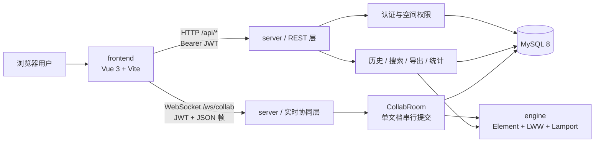
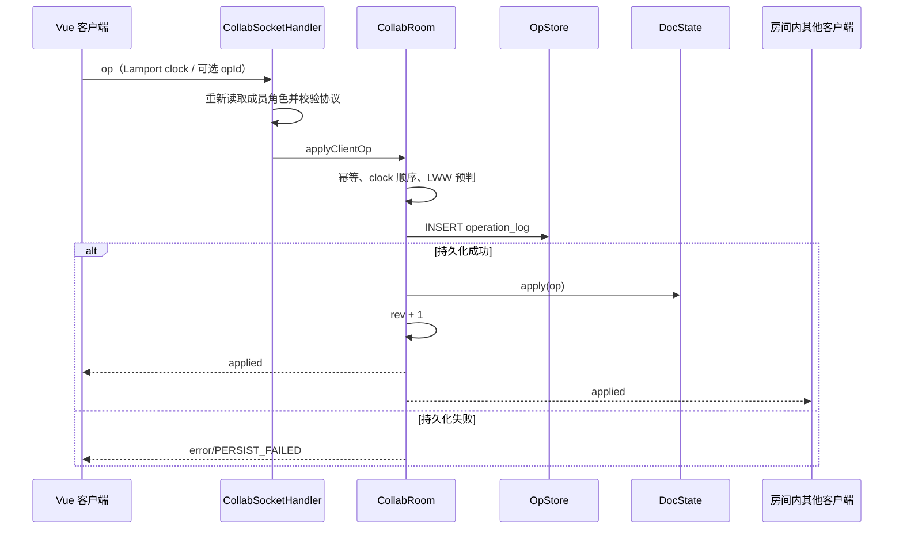
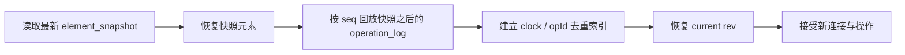

# 系统架构说明

本文描述“基于SpringBoot的协同编辑系统设计与实现”的当前实现架构。项目范围以开题报告和任务书为准：仅包含协同文档、协同白板、协同看板三类应用，以及 JWT 认证、空间角色、持久化、版本历史、检索、按内容类型的多格式导出和协同统计。协同算法采用自研元素模型、元素级 LWW 与 Lamport 时钟，不实现字符级 CRDT；白板不包含自由绘制。

相关文档：[数据库设计](database-er.md) · [REST API](api-reference.md) · [WebSocket 协议](websocket-protocol.md) · [部署说明](deployment.md) · [测试计划](test-plan.md) · [答辩演示](demo-guide.md)

## 1. 总体结构

| 模块 | 职责 | 主要入口 |
|---|---|---|
| `engine/` | 统一元素模型、Lamport 全序、元素级 LWW、墓碑删除、状态哈希 | `engine/src/main/java/com/bishe/engine/` |
| `server/` | Spring Boot 3 应用，提供 REST、WebSocket、JWT、权限、历史和持久化 | `server/src/main/java/com/bishe/server/` |
| `frontend/` | Vue 3 工作台与三类编辑器，共用实时连接组合函数 | `frontend/src/` |
| `db/` | MySQL 8 初始化表结构与索引 | `db/init.sql` |

构建基线为 Java 17；Spring Boot 当前版本由 `server/pom.xml` 管理。前端依赖见 `frontend/package.json`。

## 2. 两条业务链路

### 2.1 REST 控制面

REST 负责不要求逐操作实时广播的业务：

- 注册、登录、当前用户与 token 刷新；
- 空间创建、成员查询、邀请和角色调整；
- 文档元数据的列表、创建、读取、改名和软删除，以及所有者回收站的查询、恢复；
- 历史时间线、指定版本回放、历史恢复；
- 标题/正文检索、按内容类型的多格式导出、个人可见范围内的协同统计。

除注册、登录、健康检查外，`/api/**` 均由 `JwtAuthFilter` 校验 `Authorization: Bearer <JWT>`。业务层再按 `space_member.role` 判断资源权限，不能只依赖 token 中签发时的角色提示。

### 2.2 WebSocket 数据面

WebSocket 负责元素操作、初始/增量同步、在线成员和心跳。浏览器先完成 HTTP 握手，再发送 `hello` 加入一个持久化文档房间；新版 `op` 使用完整元素 `STATE`；`ADD/PUT/DELETE` 仅用于兼容旧日志、旧客户端和 DOC 标题投影。详细报文见 [WebSocket 协议](websocket-protocol.md)。

持久化写入是提交点：数据库追加成功后才修改内存状态、推进 `rev` 并广播。因此数据库失败不会产生“客户端已看到但重启后丢失”的内存提交。

## 3. 协同引擎

### 3.1 统一元素模型

一个文档状态 `DocState` 是按 `elementId` 索引的 `Element` 集合。元素包含：

- `id`：元素标识；
- `type`：`DOC`、`TEXT`、`IMAGE`、`CARD`、`TASK` 或 `COLUMN`；
- `rootClock`：元素创建/类型声明的 Lamport 时钟；
- `fields`：字段名到 `FieldValue(value, writtenAt)` 的映射；
- `#tombstone`：值为 `true` 时表示删除，仍保留在状态和历史中。

三类应用只是字段投影不同：

| 应用 | 主要元素 | 典型字段 |
|---|---|---|
| 文档 | `DOC`、`TEXT`、`IMAGE` | `title`、`text`、`order`、`assetId`、`url`、`width/height` |
| 白板 | `CARD`、`IMAGE` | `text`、`x`、`y`、`w`、`h`、`color`、`z` |
| 看板 | `COLUMN`、`CARD` | `title`、`text`、`column`、`order`、`coverId/coverName/coverUrl` |

字段集合由编辑器当前实现决定；引擎本身只负责确定性合并，不理解具体 UI。

### 3.2 Lamport 与元素级 LWW

新版 `STATE.value` 携带整个元素的业务字段；比较键为 `(counter, replicaId, opId)`，较大版本整体替换该元素，字段统一记录同一时钟。保留字段 `#version` 记录获胜操作 ID，`#tombstone` 记录删除状态。删除和复活都是完整元素状态更新。

同一组有效操作最终送达、比较规则相同、重复操作去重且编辑停止时，各副本收敛。同元素并发修改即使涉及不同属性，也可能被较大的完整状态覆盖；日志保留已接受的新版操作，包括未改变最终业务视图的冲突操作。不同元素独立合并。

旧版字段操作可以回放；一旦元素出现 `STATE`，新版状态优先于旧版字段操作，服务端拒绝后续旧版写入并返回 `UPGRADE_REQUIRED`。这样迁移、乱序与快照合并使用相同规则。DOC 根标题仍采用 REST 元数据及兼容投影，不向客户端开放 `STATE` 写标题。

### 3.3 图片链路

`POST /api/docs/{docKey}/images` 校验角色、8MB 大小、实际图片格式和尺寸，保存文件及 `image_asset` 元数据；客户端随后把 `assetId/url/name/width/height/mimeType/status` 写入元素。图片二进制不进入协同帧或操作日志。

图片文件通过受 JWT 和当前空间成员关系保护的 `GET /api/assets/{assetId}` 读取，前端使用带认证的 fetch 与临时 Blob URL 显示。替换和删除只更新元素引用，旧资源继续保留供历史恢复。导出按当前已提交快照生成，内嵌资源只读取同内容所属的本地图片。

## 4. 房间、版本与恢复

每个 `docKey` 对应一个 `CollabRoom`。房间通过有界单写队列和提交锁串行化以下动作：

- 操作去重与校验；
- 服务端 `rev` 分配；
- `operation_log` 持久化；
- 内存状态提交与广播；
- 加入房间时的同步与会话注册。

写命令可在约 1 ms 内聚合为事务微批，持久化成功后才逐条提交并把广播放入各连接的有界出站队列。这样既避免客户端加入期间漏掉恰好并发提交的操作，也避免慢连接直接阻塞房间写线程。房间最后一个连接离开 90 秒且写队列排空后可被驱逐；再次访问时从 MySQL 重建。

### 4.1 启动/重建恢复

当前实现以 64 个服务端版本为快照边界；写微批跨过边界后，会异步保存该批次最终版本的快照。快照失败不会回滚已经成功追加的日志，后续仍可依靠完整日志恢复；新快照可在之后追平。

### 4.2 历史回放与恢复

回放在指定 `rev` 上重建只读状态。恢复不会删除旧日志或覆盖历史记录，而是：

1. 重建目标版本与当前版本；
2. 对新版元素生成完整状态，对旧版元素计算字段差异；
3. 用 `server-restore` 副本生成严格向前的 Lamport 操作；
4. 通过房间正常持久化、应用并广播。

因此“恢复”本身也是可审计的新历史，可再次向前或向后恢复。

## 5. 一致性与故障边界

| 场景 | 行为 |
|---|---|
| 重复 `clock` 或重复 `opId` 且载荷一致 | 幂等确认，不新增 `rev` |
| 相同 `clock`/`opId` 对应不同载荷 | 拒绝为冲突 |
| 新版 STATE 未获胜 | 仍追加已接受操作日志、推进 rev 并确认；状态保持最大版本 |
| 兼容旧版字段操作过旧 | 返回 `STALE_OP`，不落库、不增 `rev` |
| 数据库追加失败 | 不改内存、不广播，客户端收到 `PERSIST_FAILED` |
| 客户端断线 | 按 `lastRev` 请求增量；无法连续补齐时返回全量快照 |
| 成员权限在连接后变化 | 每条写操作重新查角色；viewer 被拒写，成员失效则关闭连接 |

本项目采用单服务实例内的房间串行化与 MySQL 持久化，没有实现多服务节点间的房间协调。部署时应保持单实例写入；这符合毕设范围，不能把当前架构描述为已支持水平扩展。

## 6. 安全与数据范围

- 密码以 BCrypt 哈希存储，JWT 通过 Auth0 java-jwt 4.5.0 签发、验证签名与有效期，使用 HS256，`JWT_SECRET` 至少 32 字节；
- 文档访问以空间成员关系为边界，`owner`、`editor`、`viewer` 权限见 [REST API](api-reference.md#3-权限矩阵)；
- 文档删除为软删除，操作日志、快照与图片资源保留；所有者可从回收站恢复原内容，恢复与删除使用同一内容锁协调，幂等恢复不关闭活跃房间；
- REST 错误不返回 SQL 或异常堆栈；
- WebSocket 文本帧上限为 64 KiB，入站字段和值有长度与类型校验；
- 当前 WebSocket 配置允许任意 Origin，正式网络部署应由同源反向代理和网络访问控制限制入口，详见 [部署说明](deployment.md)。

## 7. 源码索引

- 引擎：`engine/src/main/java/com/bishe/engine/DocState.java`、`Element.java`、`FieldValue.java`、`LamportClock.java`、`Op.java`
- 实时层：`server/src/main/java/com/bishe/server/ws/CollabSocketHandler.java`、`CollabRoom.java`、`CollabSession.java`、`RoomRegistry.java`
- 持久化：`server/src/main/java/com/bishe/server/store/OpStore.java`、`SchemaMigrationRunner.java`
- 历史：`server/src/main/java/com/bishe/server/history/HistoryService.java`
- 权限：`server/src/main/java/com/bishe/server/auth/JwtAuthFilter.java`、`AccessService.java`
- 前端实时状态：`frontend/src/composables/useCollabSocket.js`、`frontend/src/collab/`
