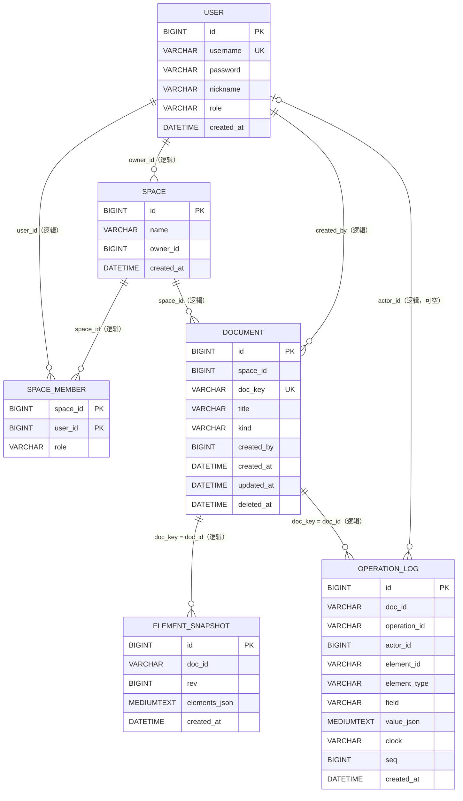
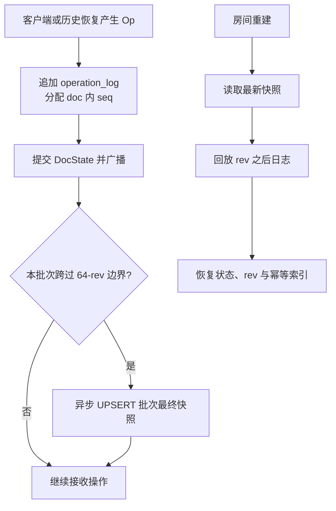

# 数据库与 ER 设计

## 2026-10-17 图片资源扩展

新增 `image_asset` 表，`asset_id` 为唯一资源 ID，`doc_id` 关联内容并继承其空间权限。字段包含 `original_name`、`mime_type`、`byte_size`、`width`、`height`、`storage_path`、`created_by`、`created_at`，索引为 `(doc_id, created_at)`。图片本体存文件系统，必须随数据库一同备份；表结构与幂等迁移见 `db/init.sql` 与 `SchemaMigrationRunner`。

新版操作的 `operation_log.clock` 前缀为 `STATE|`，`field` 保存获胜比较使用的 opId，`value_json` 保存完整标量字段对象；`operation_id` 保留去重标识。元素快照仍使用原 JSON 结构，业务字段统一记录元素版本，额外 `#version` 字段保存获胜 opId。历史中的 v1 字段日志继续兼容。所有已接受 STATE（包括并发未获胜状态）都保留日志，审计与统计共享这些记录。


数据库使用 MySQL 8、InnoDB 与 `utf8mb4`。初始化脚本为 `db/init.sql`，运行时访问集中在 `server/src/main/java/com/bishe/server/store/`。本页描述当前六张业务表、逻辑关系、索引和恢复策略。

相关文档：[系统架构](architecture.md) · [REST API](api-reference.md) · [部署与备份](deployment.md) · [测试计划](test-plan.md)

## 1. 逻辑 ER 图



当前 DDL 没有声明 SQL `FOREIGN KEY`。图中关系由应用层维护，部署、迁移或手工修复数据时不能依赖数据库自动级联或引用完整性检查。

## 2. 表说明

### 2.1 `user`

平台账号表。

| 字段 | 类型/约束 | 语义 |
|---|---|---|
| `id` | `BIGINT UNSIGNED`, PK, auto increment | 用户标识 |
| `username` | `VARCHAR(64)`, unique, not null | 登录名；应用限制为 3–32 位 `[A-Za-z0-9_-]` |
| `password` | `VARCHAR(128)`, not null | BCrypt 哈希，不存明文 |
| `nickname` | `VARCHAR(64)`, not null | 展示名；当前应用限制最长 32 字 |
| `role` | `VARCHAR(16)`, default `editor` | 平台账号字段；空间权限以 `space_member.role` 为准 |
| `created_at` | `DATETIME` | 注册时间 |

### 2.2 `space`

协作内容的隔离单元。

| 字段 | 类型/约束 | 语义 |
|---|---|---|
| `id` | `BIGINT UNSIGNED`, PK | 空间标识 |
| `name` | `VARCHAR(128)`, not null | 空间名 |
| `owner_id` | `BIGINT UNSIGNED`, not null | 创建者/所有者用户标识 |
| `created_at` | `DATETIME` | 创建时间 |

创建空间时，`SpaceRepo.create` 在同一事务中写入 `space`，并在 `space_member` 中加入一条 `owner` 记录。

### 2.3 `space_member`

用户与空间的多对多关联及资源权限来源。

| 字段 | 类型/约束 | 语义 |
|---|---|---|
| `space_id` | composite PK | 所属空间 |
| `user_id` | composite PK | 成员用户 |
| `role` | `VARCHAR(16)` | `owner`、`editor` 或 `viewer` |

`(space_id, user_id)` 复合主键保证一个用户在同一空间只有一个当前角色。旧数据中的 `admin` 在初始化及启动迁移时转为 `owner`；代码仍把 `admin` 当作 `owner` 兼容读取。

### 2.4 `document`

三类应用共享的元数据表。

| 字段 | 类型/约束 | 语义 |
|---|---|---|
| `id` | `BIGINT UNSIGNED`, PK | 内部自增标识 |
| `space_id` | `BIGINT UNSIGNED`, not null | 所属空间 |
| `doc_key` | `VARCHAR(36)`, unique | REST 路径和 WebSocket 房间键，当前由 UUID 生成 |
| `title` | `VARCHAR(256)`, not null | 标题 |
| `kind` | `VARCHAR(16)`, default `doc` | `doc`、`board`、`kanban` |
| `created_by` | `BIGINT UNSIGNED`, not null | 创建用户 |
| `created_at` | `DATETIME` | 创建时间 |
| `updated_at` | `DATETIME` | 元数据更新时间 |
| `deleted_at` | nullable `DATETIME` | `NULL` 为有效，非空为软删除 |

索引 `idx_document_space_active(space_id, deleted_at, updated_at)` 支持按空间过滤有效文档并按更新时间展示。删除只更新 `deleted_at`，不会删除日志和快照。

### 2.5 `element_snapshot`

文档元素状态快照。

| 字段 | 类型/约束 | 语义 |
|---|---|---|
| `id` | `BIGINT UNSIGNED`, PK | 快照记录标识 |
| `doc_id` | `VARCHAR(64)`, not null | 逻辑关联 `document.doc_key` |
| `rev` | `BIGINT UNSIGNED`, not null | 快照时服务端版本 |
| `elements_json` | `MEDIUMTEXT`, not null | 元素、字段值和 Lamport 时钟序列化结果 |
| `created_at` | `DATETIME` | 快照时间 |

唯一索引 `uk_doc_rev(doc_id, rev)` 使同一版本快照可幂等覆盖。当前实现以 64 个 `rev` 为边界；写微批跨过边界后异步保存该批次最终版本的快照。

### 2.6 `operation_log`

append-only 协同操作日志，是恢复、历史、统计和幂等的依据。

| 字段 | 类型/约束 | 语义 |
|---|---|---|
| `id` | `BIGINT UNSIGNED`, PK | 全局记录标识 |
| `doc_id` | `VARCHAR(64)`, not null | 逻辑关联 `document.doc_key` |
| `operation_id` | `VARCHAR(96)`, nullable | 客户端 `opId`；缺省时写 Lamport clock；旧行可空 |
| `actor_id` | `BIGINT UNSIGNED`, nullable | 提交用户；历史恢复等服务端操作为空 |
| `element_id` | `VARCHAR(64)`, not null | 目标元素 |
| `element_type` | `VARCHAR(16)`, nullable | `DOC/TEXT/CARD/TASK/COLUMN`；旧日志允许空 |
| `field` | `VARCHAR(64)`, not null | `PUT` 字段；删除编码为 `#tombstone` |
| `value_json` | `MEDIUMTEXT`, nullable | JSON 标量值，包括 JSON `null`；容量覆盖协议允许的 32,768 字符正文 |
| `clock` | `VARCHAR(64)`, not null | `OpType|replicaId:counter` |
| `seq` | `BIGINT UNSIGNED`, not null | 每文档单调递增的服务端版本 |
| `created_at` | `DATETIME` | 服务端落库时间 |

关键唯一索引：

- `uk_doc_seq(doc_id, seq)`：一个文档内版本唯一；
- `uk_doc_operation_id(doc_id, operation_id)`：跨断线重发的持久化幂等键。

`operation_id` 允许 `NULL` 是为了兼容早期数据；MySQL 唯一索引允许多行 `NULL`。当前新写入在客户端未提供 `opId` 时使用 `clock`，因此正常新日志仍有稳定操作标识。

## 3. 写入与恢复关系



`operation_log` 是权威事件序列，快照只是缩短状态恢复路径。不能只备份快照而忽略日志，也不能在没有完整评估历史、幂等和统计影响时清理日志。

## 4. 一致性约束与注意事项

- `document.doc_key` 与两张协同表的 `doc_id` 是字符串逻辑关联，字段长度不同但当前 UUID 值可兼容；
- `space.owner_id` 与 `space_member` 中的 `owner` 应一致，应用创建路径会同时写入；手工 SQL 修改时需自行保持一致；
- `document.updated_at` 由元数据更新触发，协同操作写入 `operation_log` 不会自动更新文档元数据时间；
- `actor_id IS NULL` 表示服务端生成操作，统计中展示为“系统”；
- `element_type IS NULL` 仅用于兼容旧日志，启动迁移会按文档类型和字段形态回填；
- 软删除文档不应出现在正常列表、搜索和统计中，但历史数据仍保留以便审计与备份恢复。

## 5. 启动迁移策略

`SchemaMigrationRunner` 针对早期开发库执行幂等、非破坏迁移：

1. 为 `document` 补 `kind`、`deleted_at` 和活动文档索引；
2. 为 `operation_log` 补 `element_type`、`operation_id`、`actor_id` 和幂等索引，并把早期的 `value_json TEXT` 扩为 `MEDIUMTEXT`；
3. 依据文档类型回填旧 `element_type`；
4. 把旧 `space_member.role='admin'` 迁为 `owner`。

全新部署仍应以 `db/init.sql` 为准；启动迁移不是完整版本化迁移框架，也不能替代部署前备份。

## 6. 备份校验点

备份与恢复命令见 [部署说明](deployment.md#7-备份与恢复)。恢复后至少核对：

```sql
SELECT COUNT(*) FROM `user`;
SELECT COUNT(*) FROM `space`;
SELECT COUNT(*) FROM `document` WHERE `deleted_at` IS NULL;
SELECT `doc_id`, MAX(`seq`) AS `max_rev`, COUNT(*) AS `ops`
FROM `operation_log` GROUP BY `doc_id`;
SELECT `doc_id`, MAX(`rev`) AS `latest_snapshot`
FROM `element_snapshot` GROUP BY `doc_id`;
```

然后启动服务并对抽样文档执行全量 `welcome`、历史回放和一次新写入。实际备份恢复结果需记录在 [测试计划](test-plan.md) 的执行表中；未执行前统一标记为“待最终验证”。
