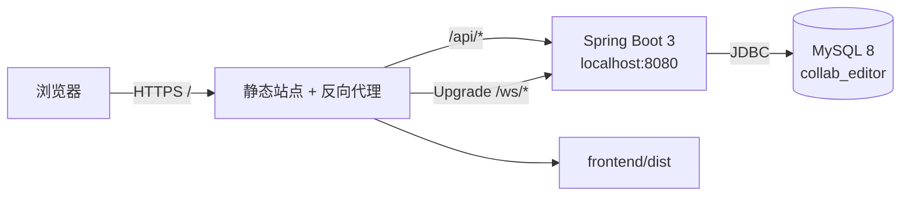
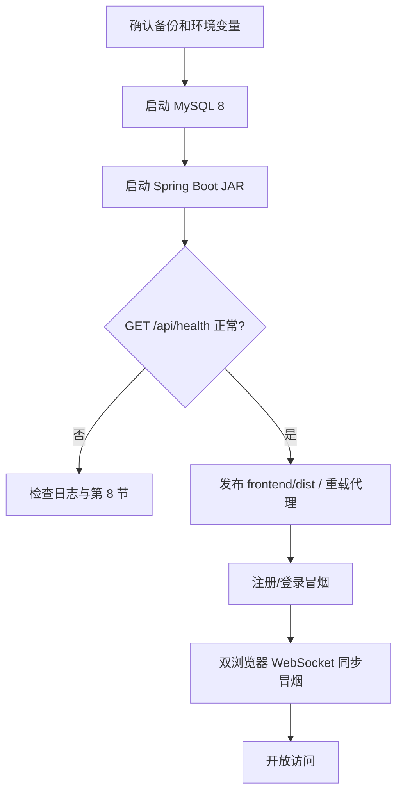

# 部署与运维说明

> 2026-10-22 更新：启动脚本、外置本地配置、成员实时权限与标题同步已纳入当前工程。IDE 使用步骤见 [本地开发](local-development.md)。[2026-10-17 需求对照](report-alignment-20261017.md) 和下文 2026-09-20 数值均为各自日期的历史记录，不代表当前工作树的最终验收数字。

## 图片资源目录与备份

环境变量 `UPLOAD_DIR`（默认运行目录的 `./data/uploads`）指定图片本体目录。使用可写持久磁盘和固定绝对路径；不要在服务运行后随意移动目录。上传支持 PNG/JPEG/GIF、8MB、2400 万像素和单边 10000 像素限制。服务启动会非破坏地创建 `image_asset` 表，无需删除旧库。

图片文件与 MySQL `image_asset` 元数据必须一并备份。数据库日志、快照中的资源引用也依赖这些文件；只有数据库备份不能恢复图片。迁移时保持原存储路径，或同步更新 `storage_path` 与 `UPLOAD_DIR`；恢复后实际打开图片、回放旧版本并执行含图导出验证。替换和删除元素保留旧资源，不能直接清理文件，否则历史图片会缺失。

PNG 导出依赖 Java AWT 可用中文字体。Windows 验证使用 Microsoft YaHei；Linux 环境需安装中文字体（如 Noto CJK），通过导出检查汉字可见。导出为静态图片，GIF 在 Word 和 PNG 中使用首帧。对外部署仍为单实例服务，静态资源与 `/api`、`/ws` 建议同源代理。

测试中 `application-test.yml` 使用 `./target/test-uploads`；2026-10-17 浏览器记录使用 `artifacts/runtime/e2e-uploads`。当前测试应显式指定独立上传目录和 `collab_editor_test` 库，实际位置以运行记录为准。JUnit 会重建测试库，不要与端到端服务并行执行。


本文覆盖本项目的开发启动、正式构建、同源反向代理、数据库初始化、备份恢复和常见故障。项目当前没有 Docker 配置，不把 Docker 作为交付前提。

相关文档：[系统架构](architecture.md) · [数据库设计](database-er.md) · [REST API](api-reference.md) · [WebSocket 协议](websocket-protocol.md) · [测试计划](test-plan.md)

## 1. 部署拓扑



前端的 REST 和 WebSocket 地址均使用当前页面同源路径，因此正式部署必须让静态站点、`/api` 和 `/ws` 对外表现为同一 Origin。开发环境由 Vite 代理完成；正式环境由 Nginx 或等价反向代理完成。

## 2. 环境要求

| 组件 | 要求 | 依据 |
|---|---|---|
| JDK | Java 17 | 根 `pom.xml` 的 `maven.compiler.release=17`，与任务书一致 |
| Maven | 能构建 Maven 3 项目 | `pom.xml`、`engine/pom.xml`、`server/pom.xml` |
| MySQL | MySQL 8 | DDL、窗口外 SQL 与测试基线 |
| Node.js | 22 LTS（至少 22.12）或 24 LTS | 同时满足 Vite 6 与当前 Vitest 5；只运行 Vite 的最低 Node 18 不适用于完整开发测试 |
| npm | 与所用 Node.js 配套 | `frontend/package-lock.json` |

`README.md` 中若出现本机 JDK 21，只表示曾用该运行时执行；项目编译目标与正式交付基线仍是 Java 17。

首次检查：

```powershell
java -version
mvn.cmd -version
node --version
npm --version
mysql --version
```

## 3. 配置与密钥

主配置位于 `server/src/main/resources/application.yml`：

| 配置 | 环境变量 | 默认值 | 说明 |
|---|---|---|---|
| `spring.datasource.url` | `DB_URL` | `jdbc:mysql://localhost:3306/collab_editor?...` | 也可用 Spring 标准环境变量 `SPRING_DATASOURCE_URL` 覆盖 |
| `spring.datasource.username` | `DB_USER` | `root` | 数据库用户 |
| `spring.datasource.password` | `DB_PASSWORD` | 空 | 数据库密码 |
| `app.jwt.secret` | `JWT_SECRET` | 空 | 必填，UTF-8 长度至少 32 字节 |
| `app.jwt.expire-hours` | 可用 `APP_JWT_EXPIRE_HOURS` 覆盖 | `168` | 允许 1–720 小时 |
| `server.port` | 可用 `SERVER_PORT` 覆盖 | `8080` | 后端监听端口 |
| `app.upload-dir` | `UPLOAD_DIR` | `./data/uploads` | 图片本体持久化目录，正式环境使用固定绝对路径 |
| Vite 后端代理 | `VITE_PROXY_TARGET` | `http://localhost:8080` | 仅开发服务器使用，HTTP 与 WebSocket 同时调整 |

生产环境必须通过进程环境、服务管理器或密钥管理系统注入密码与 JWT 密钥，不要写入 Git、部署文档或前端变量。示例仅使用占位符：

```powershell
$env:DB_URL = 'jdbc:mysql://localhost:3306/collab_editor?useUnicode=true&characterEncoding=utf8&serverTimezone=Asia/Shanghai'
$env:DB_USER = '<database-user>'
$env:DB_PASSWORD = '<database-password>'
$env:JWT_SECRET = '<random-secret-of-at-least-32-bytes>'
$env:UPLOAD_DIR = '<absolute-persistent-upload-directory>'
```

`JWT_SECRET` 不足 32 字节时应用会拒绝启动，这是预期的安全检查。同一部署中的服务重启必须继续使用原密钥，否则已有 token 会全部失效。

本机 `server/src/main/resources/application-local.yml` 被 Git 忽略，并通过 Maven 的 resources 排除规则留在 JAR 外部。IDEA 自带 `.run/CollabServer-local.run.xml` 同时传入 `--spring.profiles.active=local` 和 `--spring.config.additional-location=optional:file:./server/src/main/resources/`；工作目录须为项目根目录。只启用 profile 不等于已加载外部文件。启动脚本会拒绝夹带 `application-local.*` 的旧 JAR，可去掉 `-SkipBuild` 重新构建。

## 4. 数据库初始化

全新环境执行一次 `db/init.sql`：

```bash
mysql -u root -p < db/init.sql
```

PowerShell 可通过 `cmd` 使用重定向：

```powershell
cmd /c "mysql -u root -p < db\init.sql"
```

脚本会创建 `collab_editor` 与七张表（包含 `image_asset`）。随后用应用账号验证：

```sql
USE collab_editor;
SHOW TABLES;
SHOW INDEX FROM operation_log;
```

已有开发库不应删除重建。应用启动时的 `SchemaMigrationRunner` 会幂等补齐早期字段和索引，并迁移旧角色；执行前仍应先备份，详见第 7 节。

## 5. 构建与测试

### 5.1 后端

Spring 集成测试只允许连接独立数据库 `collab_editor_test`，保护器会拒绝其他库名。设置测试凭据后运行：

```powershell
$env:TEST_DB_USER = '<test-database-user>'
$env:TEST_DB_PASSWORD = '<test-database-password>'
mvn.cmd test
```

测试通过后构建可执行 JAR：

```powershell
mvn.cmd clean package -DskipTests
```

产物为 `server/target/server-0.1.0.jar`。详细测试矩阵和记录要求见 [测试计划](test-plan.md)。

### 5.2 前端

```powershell
Set-Location frontend
npm ci
npm test
npm run build
```

生产静态文件输出到 `frontend/dist/`。`npm run build` 成功只证明可编译，仍需执行浏览器端验收。

## 6. 启动方式

### 6.1 本地开发

在项目根目录打开 `collab-editor.code-workspace`，可使用 VS Code 的“启动后端（local）”“启动前端（Vue）”或“同时启动前后端”任务。IDEA 后端已运行时只启动前端任务。详细导入、JDK、外部配置与故障说明见 [本地开发](local-development.md)。

也可在两个 PowerShell 终端分别运行：

```powershell
powershell -NoProfile -ExecutionPolicy Bypass -File .\scripts\start-backend.ps1
```

```powershell
powershell -NoProfile -ExecutionPolicy Bypass -File .\scripts\start-frontend.ps1
```

访问 `http://localhost:5173`。`frontend/vite.config.js` 将 `/api` 和 `/ws` 代理至 `localhost:8080`。Vite 启用 `strictPort`；两个脚本都检查目标端口，已有服务时不会结束原进程。`-CheckOnly` 仅检查环境/端口，不安装依赖、不启动服务。

自定义端口示例：后端脚本使用 `-Port 8081`；前端脚本使用 `-Port 5174 -ProxyTarget http://localhost:8081`。仅在代码未改变且 JAR 已构建时使用后端 `-SkipBuild`。直接运行 JAR 时需自行注入第 3 节环境变量或外部配置，脚本无需与 IDE 联动。

基础检查：

```powershell
Invoke-RestMethod http://localhost:8080/api/health
```

健康响应应包含 `status=UP`；数据库读写、认证和 WebSocket 仍需按 [测试计划](test-plan.md) 单独验证。

### 6.2 正式静态站点与反向代理

以下 Nginx 片段展示必要行为，域名、证书路径和静态目录需按实际环境修改：

```nginx
server {
    listen 443 ssl;
    server_name example.invalid;

    root /srv/collab-editor/frontend/dist;
    index index.html;

    location / {
        try_files $uri $uri/ /index.html;
    }

    location /api/ {
        proxy_pass http://127.0.0.1:8080;
        proxy_set_header Host $host;
        proxy_set_header X-Forwarded-Proto $scheme;
        proxy_set_header X-Forwarded-For $proxy_add_x_forwarded_for;
    }

    location /ws/ {
        proxy_pass http://127.0.0.1:8080;
        proxy_http_version 1.1;
        proxy_set_header Upgrade $http_upgrade;
        proxy_set_header Connection "upgrade";
        proxy_set_header Host $host;
        proxy_read_timeout 75s;
    }
}
```

外部页面使用 HTTPS 时，浏览器会自动连接 `wss://`。若代理未转发 `Upgrade`/`Connection`，REST 可能正常而协同连接持续失败。

### 6.3 启动顺序



## 7. 备份与恢复

### 7.1 备份

答辩前、结构迁移前和生产升级前都应生成完整备份。为得到最容易说明和复现的结果，建议进入维护窗口，先停止新写入，再执行：

```bash
mysqldump --single-transaction --default-character-set=utf8mb4 \
  -u <database-user> -p --databases collab_editor \
  > collab_editor-backup.sql
```

备份文件包含账号哈希、协同正文和历史数据，应按敏感数据保护，不能提交到 Git。

### 7.2 恢复

优先恢复到隔离的 MySQL 实例或临时环境进行验证：

```bash
mysql -u <database-user> -p < collab_editor-backup.sql
```

恢复期间停止应用写入，避免新日志与备份序列交叉。恢复后按 [数据库设计](database-er.md#6-备份校验点) 核对记录数和每文档最大 `seq`，再执行：

1. 启动应用，确认无结构迁移错误；
2. 登录并打开抽样的文档、白板和看板；
3. 检查最新状态与指定历史版本；
4. 新增一条操作并确认 `rev` 连续增长；
5. 重新连接，确认状态仍一致。

备份恢复演练的真实结果必须写入测试记录；未实际执行时标为“待最终验证”。

## 8. 常见故障

| 现象 | 检查项 | 处理方向 |
|---|---|---|
| 启动报 `JWT_SECRET 至少需要 32 字节` | `JWT_SECRET` 缺失或过短 | 注入稳定、随机、至少 32 字节的密钥后重启 |
| 数据库连接失败 | MySQL 服务、库名、用户权限、`DB_USER/DB_PASSWORD`、时区参数 | 用同一账号先执行 `mysql` 连接验证，不在日志中打印密码 |
| 启动迁移失败 | 账号缺少 `ALTER`/`UPDATE` 权限或旧结构异常 | 先备份，检查 `SchemaMigrationRunner` 涉及的列与索引 |
| `8080`/`5173` 端口占用 | 已运行进程或其他服务 | 优先使用已运行项目；另开端口时用脚本 `-Port`，前端同时指定 `-ProxyTarget` |
| REST 正常但 WebSocket 失败 | 代理 Upgrade、token、Origin/HTTPS 混用 | 检查浏览器 Network 的握手状态和 Nginx `/ws/` 配置 |
| 握手返回 `403` | query 中无有效 `token`、token 过期或用户已不存在 | 重新登录，确认 URL 编码和服务端 JWT 密钥未改变 |
| 页面显示离线或自动重试已暂停 | 后端不可达、代理超时、心跳/操作确认丢失 | 保持页面打开以保留未确认输入；检查 `/api/health` 和代理后按“重新连接”；移除成员或删除内容需返回工作台 |
| 主类启动读不到本地凭据 | 仅启用 local，未指定外部配置路径 | 使用项目自带 `.run` 配置或启动脚本；不要把本地配置复制进 JAR |
| `npm run build` 失败 | Node 版本、锁文件与安装状态 | 使用 Node 22.12+ 的 22 LTS 或 24 LTS，在 `frontend/` 执行 `npm ci` 后重试 |
| 测试拒绝启动 | 测试 JDBC URL 不是 `collab_editor_test` | 仅设置 `TEST_DB_*`，不要把测试指向开发/正式库 |

## 9. 历史发布检查表（2026-09-20）

以下保留当日结果用于追溯；当前发布应重新运行测试并记录本次结果，不沿用表内通过数。

| 检查项 | 结果 |
|---|---|
| Java 17 编译目标构建成功 | 当日已验证；构建输出路径 `server/target/server-0.1.0.jar` |
| 后端 JUnit 全量通过 | 当日 clean 轮 46/46 PASS（engine 12、server 34） |
| 前端 Vitest 与生产构建通过 | 已验证；26/26 PASS，`frontend/dist/` 已生成 |
| 独立测试库保护生效 | 已验证；测试只允许 `collab_editor_test` |
| 数据库备份与隔离恢复演练 | 未执行；正式部署或答辩前按第 7 节实施 |
| HTTPS、`/api` 与 `/ws` 同源代理 | 未执行；本机验收使用 Vite 开发代理 |
| 三角色权限和三类应用双端同步 | 已验证；最终 Playwright 14/14 PASS |
| 正式环境日志敏感信息复核 | 未执行；本机自动化未注入正式环境凭据 |

“已验证”项对应 2026-09-20 的本机最终回归；“未执行”项是部署环境动作，不把配置示例写成已经完成的生产验收。
