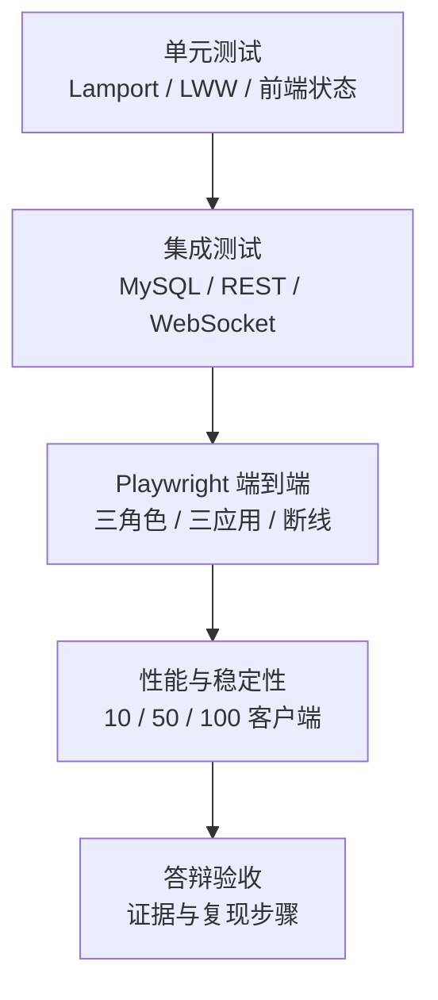
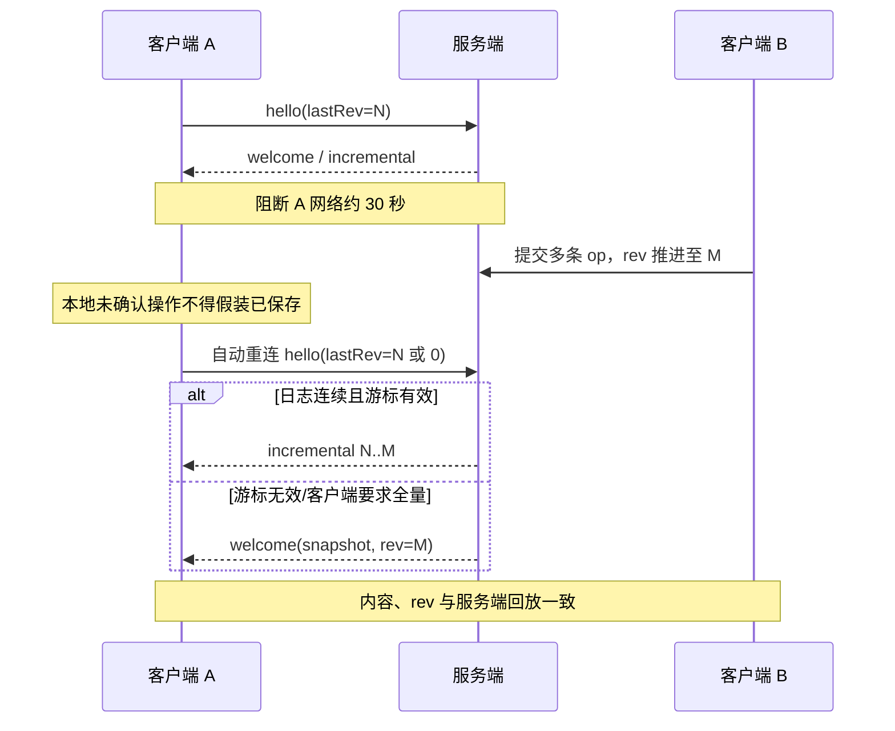

# 测试计划与验收记录模板

> 版本说明：本文件保留 2026-09-20 的历史验证表，当前功能以 2026-10-22 源码为准。2026-10-17 的图片、元素级 STATE、多格式导出记录见 [需求对照与验证](report-alignment-20261017.md)；2026-10-22 两轮改进分别见 [第一轮](improvements-20261022.md) 和 [第二轮](improvements-20261022-round2.md)。下方明确标注的历史数字不能直接作为当前版本结果。

本计划覆盖任务书要求的 JUnit 5、Playwright、多用户协作、乱序/冲突、断线恢复及延迟/吞吐记录。本文把“测试目标”“自动化现状”和“本轮实测结果”分开；任何没有在最终交付环境重新执行的结果均写为“待最终验证”，不得引用旧报告数字替代本轮结果。

相关文档：[系统架构](architecture.md) · [WebSocket 协议](websocket-protocol.md) · [部署说明](deployment.md) · [答辩演示](demo-guide.md) · 既有记录：[性能报告](performance-report.md) · [双层验证记录](verification-双层验证记录.md)

## 1. 质量目标



验收原则：

- 正确性优先于界面观感：相同操作集必须收敛，落库版本不得丢失或重复；
- 权限既测 REST，也测已建立 WebSocket 后的角色变化；
- 断线恢复不能只看“已重连”，还要核对最终 `rev`、元素值和一致性 hash；
- 性能数据必须写明硬件、JDK、MySQL、样本数、并发模型和统计口径；
- 截图只能证明可见状态，协议日志、数据库版本与自动化断言共同证明数据正确。

## 2. 测试环境与数据隔离

### 2.1 后端测试库

Spring 集成测试使用 `test` profile 和专用库 `collab_editor_test`。`TestDatabaseEnvironmentPostProcessor` 会在初始化/清理前拒绝任何其他数据库名，`schema-test.sql` 会为测试上下文重建完整结构。

PowerShell 示例：

```powershell
$env:TEST_DB_USER = '<test-database-user>'
$env:TEST_DB_PASSWORD = '<test-database-password>'
mvn.cmd clean test
```

不得把 `TEST_DB_URL`、`DB_URL` 指向 `collab_editor` 或正式数据库。测试说明见 `server/src/test/README.md`。

会重建 `collab_editor_test` 的 JUnit 与使用该库的真实浏览器、实际重启验证必须串行执行；不能一边跑端到端流程一边重建它的数据库。原有开发服务继续使用开发库。纯模拟 API/WebSocket 的界面专项不依赖 MySQL，但性能测量期间也应停止浏览器和构建任务，减少资源争用。

### 2.2 浏览器测试数据

每次运行生成唯一后缀账号和空间，例如：

- `owner_<runId>`
- `editor_<runId>`
- `viewer_<runId>`
- 空间 `验收空间_<runId>`

记录 `runId`、三个用户 ID、`spaceId` 和三个 `docKey`。自动化不得依赖数据库中“第一条文档”或固定自增 ID。

### 2.3 版本记录

每轮报告至少记录：Git commit/工作树标识、操作系统、CPU/内存、Java、Maven、Node、浏览器、MySQL、Spring Boot、开始/结束时间。密钥和密码只记录“已配置”，不记录值。2026-09-20 20:56 的最终 clean 轮实际运行于 Oracle JDK 21.0.10，项目 Maven `release` 固定为 17，因此运行 JDK 与 Java 17 编译目标应分别表述。

## 3. 自动化测试矩阵

### 3.1 引擎 JUnit 5

| 验证项 | 主要测试/建议落点 | 判定 |
|---|---|---|
| Lamport counter 优先、replicaId 平局裁决 | `LamportClockTest` | 全序与编码往返一致 |
| `observe=max(local,remote)+1` | `LamportClockTest` | 计数严格前进 |
| 同一操作集任意乱序收敛 | `ConvergenceTest`、`ConvergenceStressTest` | 所有副本 `canonicalHash` 相同 |
| 网络分区后合并 | `ConvergenceTest.partitionMergeConverges` | 双方最终 hash 相同 |
| `null` 清除阻止旧值复活 | `EngineEdgeCaseTest` | 旧时钟写入不覆盖清除值 |
| 元素类型冲突确定性 | `EngineEdgeCaseTest` | 任意到达顺序类型一致 |
| 状态合并不共享可变元素 | `EngineEdgeCaseTest` | 后续修改不串扰 |

命令：

```powershell
mvn.cmd -pl engine test
```

### 3.2 服务端 JUnit 5

| 验证项 | 现有测试 | 必须断言 |
|---|---|---|
| 注册、登录、当前用户、API 鉴权、WS token | `AuthApiTest`、`JwtUtilTest` | 签名/过期/算法/异密钥均拒绝 |
| 文档 CRUD 与段落同步 | `DocRestAndParagraphTest` | 权限、播种状态、双端值一致 |
| 空间隔离和邀请 | `SpaceIsolationTest` | 非成员不可见，角色符合矩阵 |
| 文档双端与增量恢复 | `CollabWsIntegrationTest` | `welcome`、`applied`、`incremental` 连续 |
| 白板/看板同步 | `BoardSyncTest`、`KanbanSyncTest` | 几何、列/卡字段重连后保留 |
| 严格协议、幂等与持久化提交点 | `CollabRealtimeHardeningTest` | 非法帧、重复/冲突、持久化失败不改状态 |
| 写微批与慢连接背压 | `CollabWritePipelineTest` | 批内 `seq` 连续、单次事务追加、出站有序、溢出明确关闭 |
| 快照 + 日志重启恢复 | `CollabPersistRestoreTest`、`OpStoreElementTypeTest` | 类型、`null`、旧日志、尾日志恢复 |
| 历史往返恢复 | `HistoryServiceRestoreTest` | 字段清除、墓碑复活、反复恢复 |
| Schema 幂等迁移 | `SchemaMigrationRunnerTest` | 列、索引、角色和回填均可重复运行 |
| 历史/导出/搜索/统计 | `ProductFeatureTest` | 可见范围及响应字段正确 |
| 在线改名、成员变更和删除 | `LiveMetadataTest`、`SpaceMemberControllerTest`、`ContentLifecycleApiTest` | 当前角色、实时通知、旧连接与排队写入正确失效 |
| 回收站与恢复 | `TrashControllerTest`、`TrashApiTest`、`CollabRoomLifecycleTest` | owner/admin 权限、非成员 404、重复恢复幂等、原资源/日志/快照保留、恢复后重新加入 |
| 七天活动与同名成员 | `StatsApiTest` | 数据库自然日连续补零、按 actor_id 计数、可见范围正确 |
| 导出有效输入边界 | `ContentExportBoundaryTest`、`ImageAndExportTest` | SVG/PNG 实际布局、边长/面积拒绝、DOCX 图片比例、CSV 多行公式按文字处理 |

命令：

```powershell
mvn.cmd -pl server -am test
```

### 3.3 前端 Vitest

| 文件 | 覆盖 |
|---|---|
| `frontend/src/tests/lamport.test.js` | 时钟解析、比较、tick、observe |
| `frontend/src/tests/collabState.test.js` | 快照载入、LWW 应用、删除状态 |
| `frontend/src/tests/reconnect.test.js` | 退避与版本推进 |
| `frontend/src/tests/elementState.test.js`、`elementValues.test.js`、`insertionOrder.test.js` | 完整元素合并、合法字段、排序与必要重排 |
| `frontend/src/tests/useCollabSocket.test.js`、`realtimeReliability.test.js` | 待确认重传、确认/拒绝、旧连接隔离与超时 |
| `frontend/src/tests/apiClient.test.js`、`authStore.test.js` | 统一鉴权刷新、取消、跨标签退出/切账号、旧请求隔离、同账号换发保留位置 |
| `frontend/src/tests/recentWork.test.js`、`contentPreview.test.js`、`workbenchNavigation.test.js` | 最近打开记录按账号/空间隔离，预览基于实际可见内容，返回地址 |
| `frontend/src/tests/boardViewport.test.js` | 缩放逆坐标、锚点、适应范围、边界值 |
| `frontend/src/tests/documentSearch.test.js` | 字面大小写不敏感匹配、UTF-16 选区、非文本/墓碑过滤、远端变更后的当前位置 |

命令：

```powershell
Set-Location frontend
npm ci
npm test
npm run build
```

### 3.4 Playwright 端到端

最终界面验收必须面向 `frontend/` 的 Vue 页面（开发入口默认 `http://localhost:5173`），并使用三个独立 browser context，不能只验证 `server/src/main/resources/static/` 下的早期静态页面。

当前 Vue 脚本为 `tests/e2e-ui/vue-e2e.mjs`，`npm test` 与 `npm run test:vue` 均执行该脚本；`npm run test:legacy` 仅保留早期静态页面脚本，不作为最终验收证据。项目固定使用 Playwright `1.55.1`。隔离测试后端与 Vite 启动后运行：

```powershell
Set-Location tests/e2e-ui
npm ci
npx playwright install chromium
$env:E2E_BASE_URL = 'http://localhost:5173'
npm test
```

脚本每轮把原始产物写入 `artifacts/e2e-vue/<runId>/`。当前脚本覆盖三角色、三应用、图片与多格式导出、真实历史恢复、约 30 秒断线、三端业务状态及版本比较，并保留截图、trace、延迟与统计 JSON。单独的 `live-members-title-checks.mjs` 和 `live-trash-checks.mjs` 覆盖在线元数据/权限及回收站链路，执行时同样需要真实隔离后端。

以下是 **2026-09-20 历史归档** 的文件说明，不代表当前脚本的步骤数量。该次证据按原文件复制到 `artifacts/e2e-vue-final-20260920-1300/`，并生成 `SHA256SUMS.txt`，包括：

- `summary.json`：14 个步骤的状态、耗时、唯一账号/文档键和错误数组；
- `stats.json` 与 `export-mu9tphimjpye.md`：统计 API 和 Markdown 下载内容；
- `01-*.png` 至 `10-*.png`：1440 x 960 桌面流程截图；
- `11-*.png`、`12-*.png`：`320/390/414/768 x 844` 与 `1440 x 900` 五档布局矩阵截图，覆盖仪表盘、文档、白板和看板；
- `trace-owner.zip`、`trace-editor.zip`、`trace-viewer.zip`：三个独立 browser context 的 trace。

2026-09-20 最终运行 `2026-09-20T12-59-33-742Z-mu9tphimjpye` 为 14/14 PASS。30 秒 WebSocket 传输阻断实测 `30005 ms`，断线步骤总耗时 `31900 ms`，恢复后增量补齐并刷新持久化校验通过；五档视口根节点宽度均无横向溢出；`consoleErrors`、`pageErrors`、HTTP 5xx 均为 0。完整记录见 [双层验证记录](verification-双层验证记录.md)。

截图不得包含真实密码、完整 JWT 或数据库密钥。

### 3.5 2026-10-22 第二轮界面专项

下列脚本位于 `tests/e2e-ui/`，使用模拟 REST/WebSocket，可验证界面交互和请求隔离；不能替代真实 MySQL、权限和协同落库验收。结果及截图归档到 `artifacts/round2-20261022/`，重新运行时通过脚本支持的输出目录保留上一轮证据。

| 脚本 | 核心断言 | 本轮证据子目录 |
|---|---|---|
| `home-trash-checks.mjs` | 首页最多 4 项继续工作/8 项最近更新、授权过滤、真实正文摘要与列分布、回收站恢复及迟到响应、手机布局 | `home-trash/` |
| `library-navigation-checks.mjs` | 独立栏目、刷新/前进后退/切空间、创建/打开/返回、预览失败重试、角色 | `library-navigation/` |
| `refresh-search-checks.mjs` | 邀请后刷新、403/404 缓存清理、同秒预览更新、IME 与取消迟到搜索、320px | `refresh-search/final/` |
| `action-menu-scroll-checks.mjs` | 页面底部与嵌套滚动菜单、迟到事件、键盘操作、手机边界与内外滚动 | `action-menu-scroll/` |
| `board-viewport-checks.mjs` | 10%–200% 缩放、坐标换算、适应、拖动/触控平移、取消、只读导航无写入 | `board-viewport/` |
| `cross-tab-auth-checks.mjs` | 双标签退出/换号、待确认修改与草稿边界、同账号 token 轮换、迟到响应及资料重试 | `cross-tab-auth/` |
| `stats-avatar-checks.mjs` | 头像统一续期、七天零值、同名贡献者、大数值手机布局、失败重试 | `stats-avatar/` |
| `document-find-checks.mjs` | 快捷键、循环命中、中文组合输入、Unicode 选区、远端增删不抢焦点、只读和 320px | `document-find/` |
| `kanban-navigation-checks.mjs` | 任意跨列移动/末尾排序、最新字段保留、同名与已删目标、焦点跟随、只读/断连与 320/390px | `kanban-navigation/` |

原有 `editor-quality-checks.mjs`、`realtime-reliability-checks.mjs`、`workspace-quality-checks.mjs`、`account-members-checks.mjs`、`history-assets-checks.mjs`、`overlay-checks.mjs`、`readiness-checks.mjs` 等专项继续作为回归范围。模拟请求成功、截图无溢出、真实持久化成功是不同证据，各自记录实际执行结果；最终汇总不把重复复跑当作新的覆盖数量。

当前完整结果见 [第二轮完善记录](improvements-20261022-round2.md) 和 `artifacts/round2-20261022/completion-audit.json`：18 套模拟专项 / 168 组、5 套真实后端专项 / 47 组；`frontend/dist` 连接真实测试后端另复验 19 组，重复场景不叠加覆盖数。真实 `live-productivity-checks.mjs` 通过 REST history/replay 和实际 WebSocket 发帧验证查找/缩放/跳转不写版本，以及缩放拖动、跨列移动只发送所需完整状态。

## 4. 核心功能场景

### 4.1 三角色权限

| 编号 | 前置角色 | 操作 | 预期 |
|---|---|---|---|
| RBAC-01 | `owner` | 邀请 `editor`、`viewer` | 成员列表角色正确 |
| RBAC-02 | `editor` | 新建文档、写入、恢复历史 | 成功 |
| RBAC-03 | `editor` | 邀请成员、删除内容 | `403`，界面无可执行入口 |
| RBAC-04 | `viewer` | 打开三类内容、历史、导出 | 成功且编辑控件不可用 |
| RBAC-05 | `viewer` | REST 改名/创建/恢复、WS 发 `op` | REST `403`；WS `READ_ONLY` |
| RBAC-06 | 已连接成员 | 服务端角色降为 viewer 后继续发 `op` | 每次写前重查角色并拒绝 |
| RBAC-07 | 已连接成员 | 成员关系失效或文档被删除 | 分别收到 fatal `MEMBERSHIP_REVOKED` 或 `DOCUMENT_DELETED`，连接关闭并退出编辑界面 |
| RBAC-08 | owner/editor/viewer/非成员 | 查看回收站、恢复同一内容 | owner 成功；同空间 editor/viewer `403`；非成员/不存在目标 `404` |

### 4.2 文档、白板、看板

| 编号 | 场景 | 数据断言 |
|---|---|---|
| APP-01 | 两用户编辑不同段落 | 两段均保留，双方最终 `rev`/内容一致 |
| APP-02 | 两用户同时改同一段 | 完整 `STATE` 按 `(counter, replicaId, opId)` 唯一获胜，重连后不反转；不假设字符级合并 |
| APP-03 | 段落增删与排序 | 删除元素不在可见列表，重连后不复活 |
| APP-04 | 白板新增、移动、缩放、改色、删除卡片 | `x/y/w/h/color/z/text` 同步一致 |
| APP-05 | 看板新增/改名/移动列，新增/拖拽/排序/删除卡片 | `column/order/text` 最终一致 |
| APP-06 | viewer 同时旁观 | 实时看到变化但不能产生有效写操作 |

白板验收包含卡片、图片及本地视图导航，不包含自由绘制。

### 4.3 乱序、冲突和幂等

| 编号 | 注入 | 预期 |
|---|---|---|
| CONS-01 | 同一批操作按多种随机顺序投递 | `canonicalHash` 完全相同 |
| CONS-02 | 同一 `clock`、同一载荷重复 | `duplicate=true`，`rev` 不增长 |
| CONS-03 | 同一 `clock`、不同载荷 | `CLOCK_CONFLICT` |
| CONS-04 | 同一 `opId`、同一载荷跨重连重发 | 幂等确认，数据库无第二行 |
| CONS-05 | 同一 `opId`、不同载荷 | `OP_ID_CONFLICT` |
| CONS-06 | 同会话 counter 倒退或相等 | `CLOCK_OUT_OF_ORDER` |
| CONS-07 | 更旧字段时钟到达 | `STALE_OP`，`rev` 与状态不变 |
| CONS-08 | 模拟 `operation_log` 写失败 | 内存、广播、`rev` 均不改变 |

### 4.4 断线 30 秒与恢复



执行步骤：

1. A、B 打开同一文档并记录 A 的 `lastRev=N`；
2. 通过浏览器离线、代理阻断或关闭 socket，使 A 断网约 30 秒；
3. B 在此期间新增、修改、删除不同元素；
4. A 恢复网络，观察 500 ms 起、最大 10 s 的指数退避重连；
5. 允许客户端心跳机制执行：每 15 s ping，超过 36 s 未收到 pong 主动重连；
6. 核对 A 收到增量或全量同步，最终 `rev=M`；
7. 用 `/replay?rev=M` 与客户端可见状态比较；
8. 刷新 A、B，再次确认状态不变。

本场景需同时测试“断线前无待确认操作”和“发送后未收到确认即断线”两种情况。当前客户端在页面内保留待确认操作，重新确认身份和权限后以原 `clock/opId/载荷` 有序重传；服务端幂等确认，数据库不新增重复日志。明确拒绝时回退到已确认状态；换账号或撤权时不能把旧队列写入新会话。强行刷新或关闭页面不属于持久化离线队列保证范围。

### 4.5 历史、搜索、导出和统计

- 写入至少三个可区分版本，逐个回放并核对字段；
- 恢复到旧版本，再恢复到新版本，确认两次恢复均作为新日志追加；
- 删除元素后恢复到删除前版本，在线双端与刷新后均重新可见；
- 文档、白板、看板分别导出，检查标题、卡片/列结构和 UTF-8；
- 以标题和正文关键词搜索，确认不泄露未加入空间内容；
- 统计中的 `operations`、`ownOperations`、应用/操作分类与数据库查询一致；
- 软删除后列表、搜索和统计不包含该文档，日志与快照仍保留。

第二轮进一步验证：回收站恢复仍使用原内容键和资源，重复恢复不改更新时间或关闭活跃房间；旧 fatal 删除页面需重新打开或刷新。统计返回最近 7 个数据库自然日并补零，同昵称成员按 `actor_id` 分开。导出必须覆盖超出原 7000 坐标的有效白板、真正超过 8000 边长/2400 万像素的拒绝、高宽比图片和多行公式样式 CSV 文本。

## 5. 性能与容量方案

### 5.1 负载模型

当前自动化矩阵分别执行 10、50、100 个 WebSocket 客户端，并让每档客户端加入同一真实文档房间。每客户端完成 `hello` 后执行 20 条完整元素 `STATE`，最多保留 1 条未确认操作；收到自身 clock 对应的 `applied` 后立即发送下一条。该 closed-loop 口径记录从 `send` 到对应 `applied` 的端到端时延，分散房间不属于当前自动质量门。2026-09-20 历史表采用当时的 `PUT` 操作，不能假设与当前 `STATE` 的负载完全等价。

每轮固定记录：

- 并发连接数、每连接操作数、总操作数；
- P50、P95、P99、MAX；
- 有效吞吐 `成功确认操作数 / 写入阶段秒数`；
- 成功率、错误码分布、断线数；
- 初始/最终 `rev`；
- 每个观察客户端收到的唯一 clock、连续 rev 与广播总数；
- 数据库日志增量、`operation_id` 唯一数与 seq 连续性；
- CPU、内存、MySQL 与网络环境。

### 5.2 目标与历史实测分离（2026-09-20）

| 场景 | 指标 | 目标 | 2026-09-20 实测 |
|---|---|---:|---|
| 10 客户端 × 20 ops | P50/P95/P99/MAX/吞吐 | 记录并与 200 ms 交互目标对照 | `27.90/56.57/62.37/62.77 ms`；307 ops/s |
| 10 客户端 × 20 ops | 成功率/持久化 | `100%`；无重复、无丢失 | ack 200/200；每观察端 200/200；DB 200；rev `4->204`；lost=0、duplicate=0 |
| 50 客户端 × 20 ops | P95 | **`< 200 ms` 自动质量门** | **125.50 ms，PASS** |
| 50 客户端 × 20 ops | P50/P99/MAX/吞吐 | 记录 | `72.69/167.08/178.90 ms`；604 ops/s |
| 50 客户端 × 20 ops | 成功率/持久化 | `100%`；无重复、无丢失 | ack 1000/1000；每观察端 1000/1000；DB 1000；rev `4->1004`；lost=0、duplicate=0 |
| 100 客户端 × 20 ops | P50/P95/P99/MAX/吞吐 | 记录容量表现，不设 200 ms 硬门 | `134.72/389.59/505.43/520.08 ms`；563 ops/s |
| 100 客户端 × 20 ops | 成功率/持久化 | `100%`；无重复、无丢失 | ack 2000/2000；每观察端 2000/2000；DB 2000；rev `4->2004`；lost=0、duplicate=0 |
| 引擎收敛 | 8 副本 × 3 轮 × 1000 ops | 每轮 `canonicalHash` 全部相同 | PASS；三轮时钟碰撞 864/854/851 次 |

`ConcurrentLoadTest` 已固定上述 10/50/100 同房间矩阵，并直接对 50 客户端 P95 `< 200 ms` 做硬断言。最终数据只来自 2026-09-20 20:56 的 `mvn.cmd clean test`，不与此前独立或聚焦运行混写；完整口径和证据见 [性能报告](performance-report.md) 及 `artifacts/test-reports/final-maven-20260920-2056-default/server/TEST-com.bishe.server.ws.ConcurrentLoadTest.xml`。

2026-10-22 第二轮保持原门槛和负载模型。首次全量的 50 客户端 P95 为 275.50 ms，失败记录保存在 `artifacts/round2-20261022/server/maven-174859.log`；停止其他浏览器与构建后的隔离全量复测为 199.85 ms，见 `maven-180808.log`。复测通过但距 200 ms 门槛余量很小，只能报告该次实测，不应称为稳定达标，也不能删去首次失败。当前性能结论与历史数字分别陈述。

## 6. 兼容、异常与安全测试

| 类别 | 用例 |
|---|---|
| 输入边界 | 64 KiB 帧边界、超长 `value`、非法 JSON、非对象帧、缺 `type` |
| 标识边界 | 非法 `docId/clientId/elementId/field/opId`、保留字段 `#tombstone` |
| 数值边界 | counter/lastRev 超 JS safe integer、负数、零、非整数、非有限浮点 |
| token | 缺失、篡改、过期、错误算法、超过长度、服务端密钥变化 |
| 并发加入 | join 与 apply 同时发生，不漏帧；同 `clientId` 不同用户冲突 |
| 恢复 | 无快照、仅快照、快照+尾日志、快照失败、房间驱逐后重建 |
| 数据库 | 唯一索引冲突、连接中断、SchemaMigrationRunner 重复启动 |
| 浏览器 | Chromium 桌面与移动宽度；长标题/长用户名不重叠；键盘焦点可见 |

## 7. 执行顺序

1. 清点版本与测试库，执行引擎 JUnit；
2. 执行服务端全量 JUnit；
3. 执行前端 Vitest 和生产构建；
4. 启动后端、Vue 前端，执行三角色 Playwright；
5. 执行断网 30 秒、权限撤销、历史往返恢复；
6. 在隔离数据集上执行 10/50/100 性能梯度；
7. 执行备份/隔离恢复演练；
8. 汇总日志、JSON、截图和失败复测结果；
9. 按 [答辩演示](demo-guide.md) 完整彩排一次。

## 8. 历史验收记录（2026-09-20，保留原始数字）

本节为旧版存档，可作为记录格式参考。当前源码的验收结果由本轮报告和实际证据汇总，不沿用本节通过数。

### 8.1 汇总

| 项目 | 结果 | 证据 | 执行时间 |
|---|---|---|---|
| 引擎 JUnit | PASS，4 个套件、12/12；失败/错误/跳过均为 0 | `artifacts/test-reports/final-maven-20260920-2056-default/engine/` | 2026-09-20 20:56 |
| 服务端 JUnit | PASS，16 个套件、34/34；失败/错误/跳过均为 0 | `artifacts/test-reports/final-maven-20260920-2056-default/server/` | 2026-09-20 20:56 |
| 前端 Vitest/build | PASS；8 个文件、26/26，Vite 生产构建成功 | 当前工作区 `npm.cmd test` 与 `npm.cmd run build` 输出；`frontend/dist/` | 2026-09-20 20:45 |
| Playwright 三角色/三应用 | PASS，Playwright 1.55.1，14/14；工作流桌面 1440 x 960，布局矩阵 320/390/414/768/1440；console/pageerror/HTTP 5xx 均为 0 | `artifacts/e2e-vue-final-20260920-1300/summary.json`、30 张截图、三份 trace | 2026-09-20 21:00 |
| 30 秒断线恢复 | PASS，实际阻断 `30005 ms`、步骤耗时 `31900 ms`；自动重连、增量补齐、刷新持久化均通过 | `artifacts/e2e-vue-final-20260920-1300/summary.json`、`08-editor-reconnected-after-30s.png`、`trace-editor.zip` | 2026-09-20 21:00 |
| 10/50/100 性能梯度 | PASS；50 并发 P95 125.50 ms，三档 lost=0、duplicate=0 | `artifacts/test-reports/final-maven-20260920-2056-default/server/TEST-com.bishe.server.ws.ConcurrentLoadTest.xml`、[性能报告](performance-report.md) | 2026-09-20 20:56 |
| 备份恢复 | 未执行；属于正式部署或答辩前的运维演练，不计入当前功能回归 PASS | [部署说明](deployment.md#7-备份与恢复)中的校验步骤 | 未执行 |

### 8.2 缺陷记录

| ID | 严重度 | 前置条件与复现步骤 | 预期/实际 | 修复提交 | 复测证据 | 状态 |
|---|---|---|---|---|---|---|
| 无 | - | 最终回归未发现当前覆盖范围内未关闭产品缺陷 | 46 项 Maven、26 项 Vitest、14 项 Playwright 均通过 | - | 本节所列最终证据 | Closed |

### 8.3 性能原始记录

| 并发 | 房间模型 | 每客户端 ops | 总 ops | 成功/失败 | P50 | P95 | P99 | MAX | 吞吐 ops/s | 初始/最终 rev | lost/duplicate | 一致性证据 | 环境 |
|---:|---|---:|---:|---|---:|---:|---:|---:|---:|---|---|---|---|
| 10 | 同房间 closed-loop | 20 | 200 | 200/0 | 27.90 ms | 56.57 ms | 62.37 ms | 62.77 ms | 307 | `4/204` | `0/0` | 每观察端 200 唯一 clock/rev；DB 200 唯一 operation_id、seq 5..204 | Win 11 / JDK 21.0.10 运行 / `release=17` / MySQL 8.0.45 本机 |
| 50 | 同房间 closed-loop | 20 | 1000 | 1000/0 | 72.69 ms | **125.50 ms** | 167.08 ms | 178.90 ms | 604 | `4/1004` | `0/0` | 每观察端 1000 唯一 clock/rev；DB 1000 唯一 operation_id、seq 5..1004 | Win 11 / JDK 21.0.10 运行 / `release=17` / MySQL 8.0.45 本机 |
| 100 | 同房间 closed-loop | 20 | 2000 | 2000/0 | 134.72 ms | 389.59 ms | 505.43 ms | 520.08 ms | 563 | `4/2004` | `0/0` | 每观察端 2000 唯一 clock/rev；DB 2000 唯一 operation_id、seq 5..2004 | Win 11 / JDK 21.0.10 运行 / `release=17` / MySQL 8.0.45 本机 |

原始 JUnit XML 已归档至 `artifacts/test-reports/final-maven-20260920-2056-default/`；性能明细为 `server/TEST-com.bishe.server.ws.ConcurrentLoadTest.xml`。最终 `mvn.cmd clean test` 全量结果为 engine 12/12、server 34/34，失败、错误和跳过均为 0。

上述历史范围内的证据可重跑，当次回归无失败项或未关闭产品缺陷。备份恢复和 HTTPS 代理属于目标部署环境的运维动作，未执行状态已单独标明，不将其包装为功能测试结果。当前版本结论以本轮报告为准。
