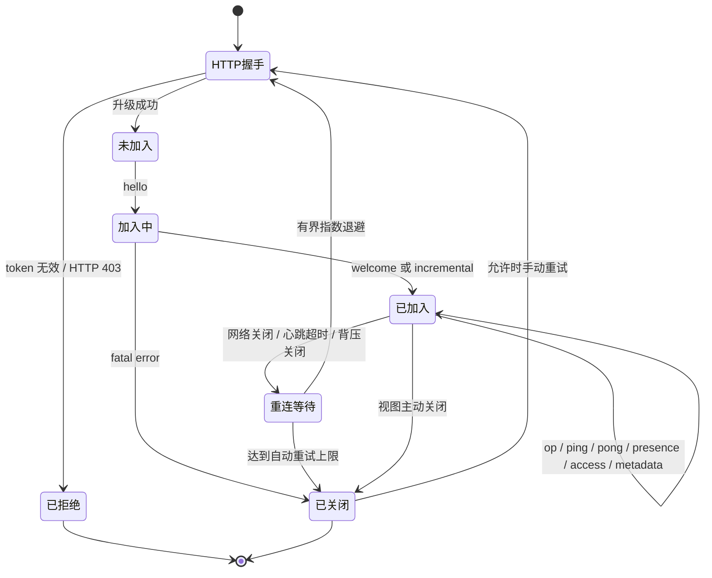
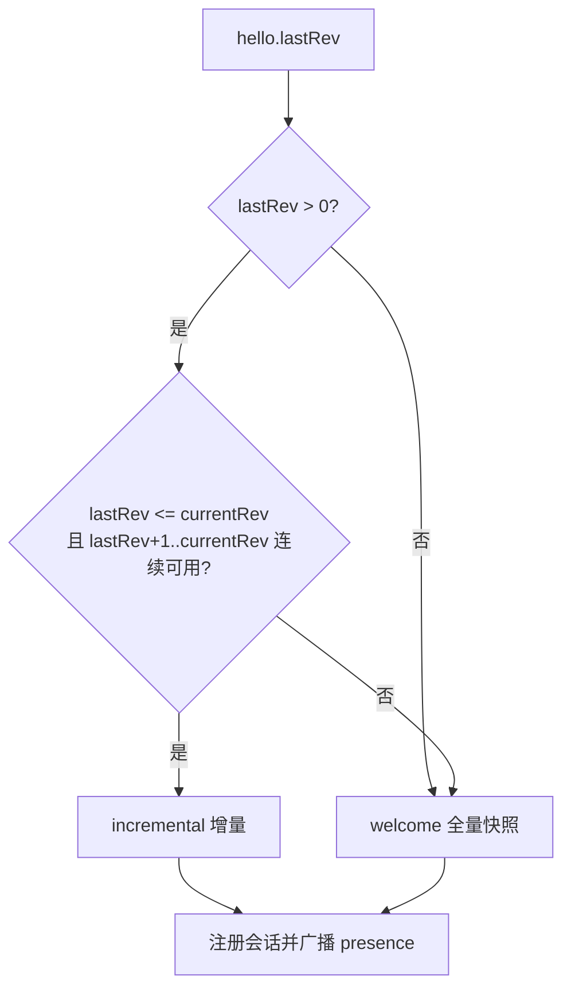
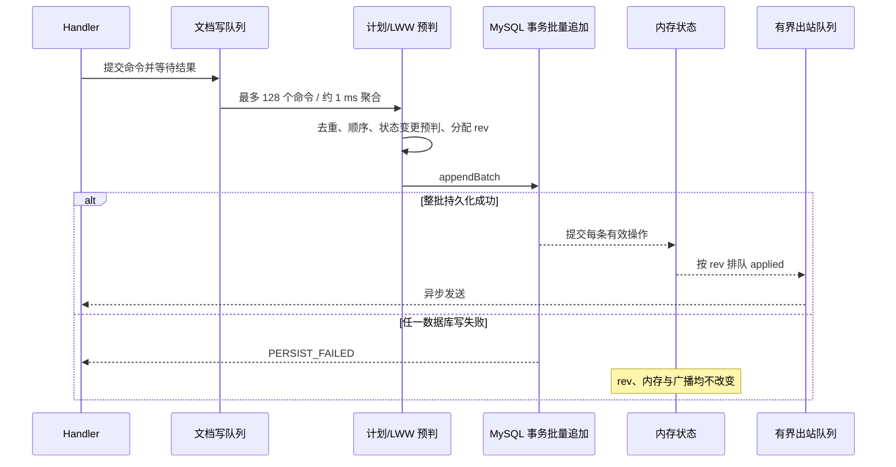

# WebSocket 协议：STATE v2 与 v1 兼容

更新于 2026-10-22。当前 Vue 客户端采用完整元素 `STATE`；v1 字段操作仅用于旧数据与兼容测试。本文同时说明暂时断线后的待确认重发、成员权限通知和标题元数据同步。

## 当前使用的 v2 完整元素协议

2026-10-17 起正式 Vue 客户端使用 `STATE`；本节优先于后文保留的 v1 字段写说明。外层 `hello/welcome/incremental/applied/presence/ping/pong`、权限校验和重连补偿结构继续复用，2026-10-22 增加服务端 `access`、`metadata` 通知。

```json
{"type":"op","op":{"type":"STATE","elementId":"image-uuid","elementType":"IMAGE","opId":"unique-op-id","clock":"client-a:100","value":{"assetId":"asset-uuid","url":"/api/assets/asset-uuid","name":"example.png","width":120,"height":80,"order":2048,"#tombstone":false}}}
```

`value` 是最多 32 个字段的对象，字段值仅为字符串、数值、布尔或 null；每个字符串最多 32768 字，整帧仍限制 64KiB。必须提供 `opId`，不可自行传入 `#version`，可传布尔 `#tombstone`。IMAGE 必须引用同一内容上传的资源；任务封面的 `coverId` 同样必须属于该内容。图片二进制通过 REST 上传，不可放入帧中。

状态比较使用 `(Lamport.counter, Lamport.replicaId, opId)`，获胜后整项替换。客户端从当前元素字段复制完整业务状态、修改属性，再提交新 `STATE`；因此同元素并发属性更改仍可能覆盖。删除是同一操作加 `#tombstone: true`。服务端接受的 STATE 均记录日志并返回 applied，未获胜操作仍推进日志 rev，以便保留冲突历史。重传同一 ID/clock 和载荷则只确认、不追加日志。

快照每个业务字段的 clock 与 `rootClock` 均为获胜状态时钟，`fields['#version']` 的 value 为获胜 opId。旧字段日志可回放；STATE 迁移后拒绝旧客户端对该元素的字段写，返回 `UPGRADE_REQUIRED`。DOC 标题使用 REST 修改，服务端保留其旧版标题投影。

以下 v1 报文用于旧数据和兼容性测试；其中“旧字段操作过期不落库”的描述不适用于 STATE。新版三端业务状态与版本比较证据见 [需求对照与验证](report-alignment-20261017.md)。


本文描述协同端点的当前 JSON 文本协议、状态机、验证规则、幂等语义、断线恢复、权限与错误处理。三类应用共用本协议，不存在文档、白板、看板三套独立传输协议。

相关文档：[系统架构](architecture.md) · [REST API](api-reference.md) · [数据库设计](database-er.md) · [部署说明](deployment.md) · [测试计划](test-plan.md)

## 1. 建立连接

端点：

```text
ws://<host>/ws/collab?token=<URL-encoded JWT>
wss://<host>/ws/collab?token=<URL-encoded JWT>   # HTTPS 部署
```

JWT 放在握手 query 中，不使用 WebSocket 子协议。握手拦截器校验 HS256 签名、有效期、用户 ID 和用户名；缺少/无效 token 或用户已不存在时，HTTP 握手直接返回 `403 Forbidden`，此时连接尚未升级，客户端收不到 JSON `error` 帧。

正式部署应使用 `wss://`，并避免在代理访问日志中记录完整 query token。

### 1.1 连接状态机



每条连接只能成功发送一次 `hello`。重复 `hello` 返回 fatal `ALREADY_JOINED` 并关闭连接。

## 2. 通用规则

- 只接受 JSON 文本帧，顶层必须是 JSON 对象；
- 每个入站帧必须有非空字符串 `type`；
- 文本帧上限为 64 KiB，超限返回 `FRAME_TOO_LARGE` 并关闭；
- 协议类型名和枚举值区分大小写；
- 未说明的额外字段当前会被忽略，但客户端不应依赖该行为扩展语义；
- 所有整数游标和 Lamport counter 不得超过 JavaScript safe integer `9007199254740991`；
- 服务端 `rev` 是每个内容独立、从 1 开始的持久化顺序号；通过校验的新 `STATE` 即使未赢得 LWW 竞争也占用一个日志版本，重复确认不递增。

入站帧只有四类：`hello`、`op`、`ping`、`pong`。出站帧有 `welcome`、`incremental`、`applied`、`presence`、`access`、`metadata`、`pong`、`error`。客户端不得提交 `metadata` 或 `access` 自行改变权限和标题。

## 3. 加入与初始同步

### 3.1 `hello`

```json
{
  "type": "hello",
  "docId": "550e8400-e29b-41d4-a716-446655440000",
  "clientId": "tab.a-7f31",
  "hostname": "doc",
  "lastRev": 24
}
```

| 字段 | 必需 | 规则 |
|---|:---:|---|
| `type` | 是 | 固定 `hello` |
| `docId` | 是 | 字符串，1–36 字符，不含空白或控制字符；不要求必须匹配 UUID 正则 |
| `clientId` | 是 | `[A-Za-z0-9._-]{1,40}`；作为 Lamport `replicaId` |
| `hostname` | 否 | 字符串，trim 后最多 64 字符，不含控制字符；仅作在线成员辅助信息 |
| `lastRev` | 否 | 非负整数且不超过 JS safe integer；默认 `0` |

加入时依次验证：当前 JWT 用户、文档未软删除、用户仍是所属空间成员。服务端角色来自数据库，`hello` 不能自报角色。

同一房间出现相同 `clientId` 时：

- 已有连接属于不同用户：新连接收到 fatal `CLIENT_ID_IN_USE`；
- 已有连接属于同一用户：新连接接管该 `clientId`，旧连接以 policy violation 关闭。

加入同步与会话注册持有和写提交相同的房间锁，因此不存在“算完快照、注册前恰好漏掉一条广播”的窗口。

### 3.2 `lastRev` 决策



- `lastRev` 缺省或为 `0`：发送 `welcome`；
- `0 < lastRev < currentRev` 且后续日志连续：发送对应 `incremental`；
- `lastRev == currentRev`：发送 `ops=[]` 的 `incremental`；
- `lastRev > currentRev` 或连续增量不可得：回退到 `welcome`；
- 回退是正常恢复路径，不是协议错误。

### 3.3 `welcome`

```json
{
  "type": "welcome",
  "clientId": "tab.a-7f31",
  "docId": "550e8400-e29b-41d4-a716-446655440000",
  "kind": "doc",
  "title": "项目说明",
  "rev": 24,
  "role": "editor",
  "canWrite": true,
  "displayName": "演示编辑者",
  "snapshot": [
    {
      "id": "paragraph-1",
      "type": "TEXT",
      "rootClock": "tab.a-7f31:8",
      "fields": {
        "text": { "value": "正文", "clock": "tab.a-7f31:8" },
        "order": { "value": 1, "clock": "tab.a-7f31:8" },
        "#version": { "value": "paragraph-write-8", "clock": "tab.a-7f31:8" }
      }
    }
  ]
}
```

`snapshot` 包含当前全部元素，**包括墓碑元素及其获胜时钟**。客户端保存墓碑参与后续合并，只在界面隐藏它们，避免较旧的待确认操作在重连后复活已删除内容。每个字段带最终值和获胜 Lamport clock；字段值可为 `null`。`docId`、`kind`、`title` 来自内容元数据；`role`/`canWrite` 是当前访问提示，真正写权限仍由服务端校验。

### 3.4 `incremental`

```json
{
  "type": "incremental",
  "docId": "550e8400-e29b-41d4-a716-446655440000",
  "kind": "doc",
  "title": "项目说明",
  "fromRev": 24,
  "toRev": 25,
  "rev": 25,
  "role": "editor",
  "canWrite": true,
  "displayName": "演示编辑者",
  "ops": [
    {
      "type": "STATE",
      "elementId": "paragraph-1",
      "elementType": "TEXT",
      "opId": "paragraph-write-11",
      "value": { "text": "重连期间的更新", "order": 1, "#tombstone": false },
      "clock": "tab.b-4c20:11"
    }
  ]
}
```

`fromRev` 是客户端提供的游标，操作覆盖 `(fromRev, toRev]`；`rev` 是兼容别名，等于 `toRev`。当前 `STATE` 操作的内层仍带 `opId`，用于完整元素版本比较；旧 PUT 可继续回放。即使 `ops=[]`，客户端也应应用本次握手提供的权限和标题元数据。

### 3.5 `metadata`：在线标题更新

```json
{
  "type": "metadata",
  "docId": "550e8400-e29b-41d4-a716-446655440000",
  "kind": "board",
  "title": "模块关系梳理（更新）"
}
```

`PUT /api/docs/{docKey}` 改名成功后，服务端向该内容的在线连接广播。客户端仅接受匹配当前 `docId` 和 `kind` 的帧，更新标题及列表对应项。相同标题不重复广播。文档继续维护兼容的 `DOC.title` 日志投影；白板、看板只更新元数据，不制造 DOC 元素或增加正文 `rev`。首次加入和重连都从 `welcome`/`incremental` 获取最新标题，历史恢复不会把元数据标题回退为旧名称。

## 4. 提交操作

### 4.1 `op` 外层

```json
{
  "type": "op",
  "docId": "550e8400-e29b-41d4-a716-446655440000",
  "clientId": "tab.a-7f31",
  "baseRev": 24,
  "opId": "tab.a-7f31:request-9",
  "op": {
    "type": "PUT",
    "elementId": "paragraph-1",
    "elementType": "TEXT",
    "field": "text",
    "value": "修改后的正文",
    "clock": "tab.a-7f31:9"
  }
}
```

当前服务端以成功 `hello` 绑定的房间与会话为准。外层 `docId`、`clientId`、`baseRev` 是客户端上下文/兼容字段，不用于选择房间，也不参与乐观锁冲突判定；即使 `baseRev` 落后，操作仍由 LWW 决定：STATE 比较完整元素版本，旧 PUT 比较字段版本。客户端不能把 `baseRev` 当作 CAS 保证。

`opId` 可放在外层或内层 `op.opId`；内层存在时优先。它必须匹配 `[A-Za-z0-9._:-]{1,64}`。推荐每条本地操作生成稳定且在同一文档内不复用的 `opId`，重连重发时保持不变。

### 4.2 v1 兼容操作类型

当前编辑器提交的 `STATE` 见开篇。本节仅描述仍可读取和接收的旧字段操作。

创建元素：

```json
{
  "type": "ADD",
  "elementId": "card-31",
  "elementType": "CARD",
  "clock": "tab.a-7f31:10"
}
```

写字段：

```json
{
  "type": "PUT",
  "elementId": "card-31",
  "elementType": "CARD",
  "field": "text",
  "value": "待办事项",
  "clock": "tab.a-7f31:11"
}
```

删除元素：

```json
{
  "type": "DELETE",
  "elementId": "card-31",
  "elementType": "CARD",
  "clock": "tab.a-7f31:12"
}
```

| 字段 | 规则 |
|---|---|
| `op.type` | 必需，`ADD`、`PUT`、`DELETE` 之一 |
| `elementId` | 必需，1–64 字符，不含空白或控制字符 |
| `elementType` | 必需，`DOC`、`TEXT`、`IMAGE`、`CARD`、`TASK`、`COLUMN` 之一 |
| `field` | `PUT` 必需，1–64 字符，不含空白/控制字符，不能为保留字段 `#tombstone` |
| `value` | `PUT` 必须显式存在；允许 JSON `null`、布尔、整数、有限浮点、字符串 |
| `clock` | 必需，`replicaId:counter`，总长最多 64 字符 |

字符串 `value` 最多 32,768 个 Java 字符；数组和对象不支持。`ADD`/`DELETE` 不允许携带 `field` 或 `value`。

### 4.3 Lamport 约束

`clock.replicaId` 必须严格等于本次 `hello.clientId`。`counter` 必须为正整数、不超过 JS safe integer，并且对同一 `clientId` 的新操作严格递增。

比较规则为 `(counter, replicaId)`：counter 大者更新；counter 相同以 replicaId 字典序决胜。服务端会从持久化日志/快照恢复每个 replica 的已接受最大 counter，不能通过断线重连复用较小 counter。

### 4.4 提交顺序和微批



每个文档写队列最多容纳 8,192 个命令；满时返回 `ROOM_BUSY`。一次排水最多聚合 128 个命令，数据库在同一事务中追加接受的操作并更新内容的 `updated_at`。失败或重复操作不会刷新最近修改时间。历史恢复的整组 diff 是一个不可被普通用户操作穿插的队列命令。

## 5. 确认、广播与幂等

### 5.1 `applied`

```json
{
  "type": "applied",
  "rev": 25,
  "opId": "tab.a-7f31:request-9",
  "op": {
    "type": "PUT",
    "elementId": "paragraph-1",
    "elementType": "TEXT",
    "field": "text",
    "value": "修改后的正文",
    "clock": "tab.a-7f31:9"
  }
}
```

新操作持久化后，`applied` 广播给房间内所有会话，包括发送者。若请求没有 `opId`，响应也不含 `opId`。

重复操作只向重发者确认：

```json
{
  "type": "applied",
  "rev": 31,
  "opId": "tab.a-7f31:request-9",
  "duplicate": true,
  "op": { "type": "PUT", "elementId": "paragraph-1", "elementType": "TEXT", "field": "text", "value": "修改后的正文", "clock": "tab.a-7f31:9" }
}
```

重复确认中的 `rev` 是确认当下房间的最新版本，不保证等于该操作首次提交时的版本。客户端用重复帧确认 pending，不能再次应用旧操作或单凭这个水位推进已接收游标，否则可能跳过中间更新。旧 v1 操作不能改变状态时返回 `error/STALE_OP`，不新增日志和 `rev`；通过校验的新 STATE 即使未获胜仍按开篇约定记录。

### 5.2 去重与冲突

服务端维护两类身份：

- Lamport `clock`：所有操作必有；
- `opId`：STATE 必填；v1 兼容操作可选，缺省使用 `clock` 作为 `operation_id`。

| 情况 | 结果 |
|---|---|
| 相同 clock、相同完整操作 | `applied` + `duplicate=true` |
| 相同 clock、不同完整操作 | `CLOCK_CONFLICT` |
| 相同 opId、相同完整操作 | `applied` + `duplicate=true` |
| 相同 opId、不同完整操作 | `OP_ID_CONFLICT` |
| counter 不大于该 replica 已接受最大值 | `CLOCK_OUT_OF_ORDER` |

完整操作比较包含类型、元素、元素类型、字段、值和 clock；数值 `1` 与 `1.0` 按等值处理。`operation_log` 的 `(doc_id, operation_id)` 唯一索引使幂等跨连接和房间重建保持有效。

## 6. 在线状态

会话加入或离开时广播：

```json
{
  "type": "presence",
  "clients": ["tab.a-7f31", "tab.b-4c20"],
  "members": [
    { "clientId": "tab.a-7f31", "displayName": "演示所有者", "hostname": "doc" },
    { "clientId": "tab.b-4c20", "displayName": "演示编辑者", "hostname": "doc" }
  ]
}
```

成员按 `clientId` 排序。`clients` 为兼容列表，UI 应优先使用 `members`。它表示在线连接而非唯一用户：同一用户可从多个 `clientId` 在线。

## 7. 心跳与客户端重连

客户端可在加入前或加入后发送：

```json
{ "type": "ping", "ts": 1789871000000, "nonce": "optional-1" }
```

服务端校验并原样回显已提供的 `ts`/`nonce`：

```json
{ "type": "pong", "ts": 1789871000000, "nonce": "optional-1" }
```

`ts` 必须是非负安全整数；`nonce` 必须是最多 64 字符且无控制字符的字符串。客户端发来的 `pong` 仅更新会话最近心跳时间，无响应帧。

当前 Vue 客户端策略：

- 每 15 秒发送一次 `ping`；
- 在心跳检查时发现超过 36 秒没有收到 `pong`，关闭旧连接并重连；握手等待上限为 20 秒，最早一条待确认操作超过 30 秒未获确认也触发恢复；
- 指数退避从 500 ms 开始，依次增大，最大 10 s；
- `hello.lastRev` 携带已确认版本，优先增量恢复；
- 暂时断线保留当前页面内存中的已确认状态与 pending，断线期间禁用新增编辑；旧连接的迟到回调立即失效；
- 收到合法 `welcome`/`incremental` 且仍有写权限后，将服务端状态与 pending 合并，并按原顺序、原 clock、原 opId、原载荷重发；不为重试生成新操作身份；
- 连续初始同步失败最多自动尝试 10 次，每条操作自动发送最多 4 次；达到上限停止自动重试并保留页面内容，可在允许时手动重试；
- 服务端明确拒绝操作时，因 error 不含被拒 opId，客户端清除当前 pending 队列、回退已确认内容，再加载权威快照，保留原因提示；
- 显式恢复历史后 `reloadSnapshot()` 清除旧 pending 并全量同步；暂时断线恢复不会调用这一清除路径；
- fatal `error` 清除内容与 pending 后以 `4003` 关闭；权限撤销、内容删除/不存在或身份变更终止当前编辑会话，不继续自动重发；恢复连接使用 `4001`，正常离开视图使用 `1000`。

pending 只保存在当前页面内存，不写入本地持久存储。离开编辑页或刷新时会提示未同步修改；强行离开、关闭浏览器仍可能丢失尚未确认输入。JWT 过期时暂停重试并提示登录，不能把旧账号的 pending 发送到新账号会话。

服务端会响应应用层心跳，但当前不依赖服务端定时器主动踢出心跳超时连接；连接失效检测主要由客户端、WebSocket 容器和网络代理共同完成。

## 8. 权限变化

加入时返回的 `role` 是会话访问提示。每个 `op` 处理前，服务端确认：

1. 连接具有握手时验证的用户主体；
2. 文档仍有效；
3. 用户仍是空间成员；
4. 当前角色仍可写。

队列实际提交时还会检查会话是否仍属于房间、当前会话角色是否可写。`viewer` 尝试提交返回非 fatal `READ_ONLY`。

所有者通过 REST 修改成员角色后，该成员在空间内的所有在线标签页立即收到：

```json
{
  "type": "access",
  "role": "viewer",
  "canWrite": false,
  "displayName": "演示编辑者",
  "message": "空间所有者已将你的权限改为只读"
}
```

升为 `editor` 后 `canWrite=true`，可在原连接恢复编辑；降为只读时立即禁用编辑，有 pending 则回退并获取权威快照。该通知不修改正文 `rev`。

所有者移除成员时，服务端向该用户全部相关会话发送 fatal `MEMBERSHIP_REVOKED` 并以 `1008` 关闭；删除内容则向其所有连接发送 fatal `DOCUMENT_DELETED` 后关闭房间。删除与写提交/加入协调，尚未提交的排队操作被拒绝，已持久化日志继续保留。

## 9. 背压与慢连接

每个会话有独立有界出站队列，避免一个慢客户端阻塞整个房间写线程：

- 最多 4,096 个待发送帧；
- 待发送 JSON 的累计字符数最多 `8 * 1024 * 1024`，按 Java `String.length()` 计；
- 达到任一上限或底层发送失败时，以 `1011`（session not reliable）关闭该连接；
- 客户端随后按 `lastRev` 重连并补齐，必要时接收全量 `welcome`。

背压关闭可能来不及发送 JSON `error`，客户端必须以 socket close 作为恢复信号，不能只等待错误帧。

## 10. 错误帧与关闭状态

统一格式：

```json
{
  "type": "error",
  "code": "INVALID_OP",
  "message": "PUT 缺少 value",
  "fatal": false
}
```

### 10.1 错误码

| code | fatal | 含义/处理 |
|---|:---:|---|
| `FRAME_TOO_LARGE` | 是 | 文本帧超过 64 KiB |
| `MALFORMED_FRAME` | 是 | 非法 JSON 或顶层不是对象 |
| `MISSING_TYPE` | 否 | 缺少有效 `type` |
| `UNKNOWN_TYPE` | 否 | 不支持的帧类型 |
| `INVALID_HELLO` | 是 | `hello` 字段或范围无效 |
| `ALREADY_JOINED` | 是 | 同连接重复 `hello` |
| `AUTH_REQUIRED` | 是 | 已升级连接中认证主体无效 |
| `DOCUMENT_NOT_FOUND` | 是 | 文档不存在或已软删除 |
| `DOC_ACCESS_DENIED` | 是 | 非文档所属空间成员 |
| `CLIENT_ID_IN_USE` | 是 | 同房间同 clientId 被另一用户占用 |
| `SYNC_FAILED` | 是 | 初始同步无法进入出站队列/发送 |
| `NOT_JOINED` | 否 | 发送 `op` 前未成功 `hello` |
| `INVALID_OP` | 否 | 操作类型、标识、字段、值或 opId 不合法 |
| `INVALID_CLOCK` | 否 | clock 格式、replica 或 counter 不合法 |
| `INVALID_HEARTBEAT` | 否 | ping 的 ts/nonce 不合法 |
| `READ_ONLY` | 否 | viewer 尝试写入 |
| `MEMBERSHIP_REVOKED` | 移除时是 | 成员关系或会话失效；实际队列提交阶段也可能非 fatal 拒绝 |
| `DOCUMENT_DELETED` | 是 | 所有者删除当前内容，终止在线编辑 |
| `INVALID_IMAGE` | 否 | 图片/封面资源不属于当前内容或引用无效 |
| `UPGRADE_REQUIRED` | 否 | 对已迁移STATE的元素发送旧字段写，需刷新客户端 |
| `CLOCK_OUT_OF_ORDER` | 否 | counter 未严格递增 |
| `CLOCK_CONFLICT` | 否 | 同 clock 复用于不同操作 |
| `OP_ID_CONFLICT` | 否 | 同 opId 复用于不同操作 |
| `STALE_OP` | 否 | 旧 v1 操作不能改变当前 LWW 状态；不适用于STATE竞争失败 |
| `ROOM_BUSY` | 否 | 文档写队列已满，客户端稍后重试/重连 |
| `ROOM_CLOSED` | 视阶段 | 房间正在关闭；加入阶段 fatal，写入阶段返回错误 |
| `PERSIST_FAILED` | 否 | 数据库批量追加失败，操作未提交 |
| `SERVER_ERROR` | `hello` 时是 | 未分类服务端异常；加入后为非 fatal |

`FORBIDDEN` 不是当前服务端产生的 WebSocket code，仅被前端作为兼容权限错误识别。

### 10.2 标准关闭状态

| 状态码 | 发起方 | 场景 |
|---:|---|---|
| `1000` | 客户端 | 正常离开编辑视图 |
| `1007` | 服务端 | malformed frame、invalid hello |
| `1008` | 服务端 | 重复加入、权限/成员/文档问题、clientId 接管旧连接 |
| `1009` | 服务端 | 帧过大 |
| `1011` | 服务端 | hello 内部错误、出站队列溢出或发送不可靠 |
| `4001` | Vue 客户端 | 连接恢复、重新同步或主动重载；是否清除pending取决于触发原因 |
| `4003` | Vue 客户端 | fatal错误、终态关闭或暂停自动重试 |

收到 `fatal=true` 后不应继续在原连接发送帧；重连前先处理认证或权限原因。非 fatal 校验错误只拒绝当前帧。

## 11. 快照、日志与房间生命周期

服务端状态恢复顺序是“最新 `element_snapshot` + 快照后 `operation_log`”。同时读取完整日志建立 `rev`、clock 和 `operation_id` 索引，以支持增量和跨重连幂等。

写微批只要跨过一个 64-rev 边界，就在批次成功后异步保存该批次最终状态快照。快照失败不撤销已经持久化的操作日志。

最后一个会话离开 90 秒后，注册中心尝试驱逐房间；只有写队列完全排空时才关闭。再次连接会从 MySQL 重建。应用关闭时会关闭会话、失败未处理命令并等待共享写执行器退出。

## 12. 客户端实现检查表

- 为浏览器标签页生成符合规则且稳定到重连结束的 `clientId`；
- 每次本地操作使用严格递增 counter，并观察所有收到操作的远端 clock；
- 不能把 socket.send 成功当作持久化确认；以 `applied` 或服务端同步状态为准；
- 本地乐观应用必须仍能接受服务端广播幂等重放；
- `duplicate=true` 只确认 pending，不重放旧状态、不单凭其rev推进同步游标；
- `welcome` 替换已确认状态并保留墓碑，`incremental` 应用增量；二者均更新权限及标题后再合并/重发可写pending；
- 初始同步信息不合法时请求全量恢复，暂断不清空pending；明确拒绝或失权时回退并停止相关写入；
- viewer 隐藏/禁用编辑入口，但不能只靠 UI 权限；
- 断线、`1011`、`ROOM_BUSY`、`PERSIST_FAILED` 均需保留清晰提示并允许恢复；
- 不在日志、错误上报或截图中记录完整 token。

## 13. 实现索引

- 握手与端点：`server/src/main/java/com/bishe/server/ws/WebSocketConfig.java`、`TokenHandshakeInterceptor.java`
- 帧解析与序列化：`server/src/main/java/com/bishe/server/ws/CollabMessage.java`
- 连接处理：`server/src/main/java/com/bishe/server/ws/CollabSocketHandler.java`
- 单房间写队列、幂等、同步：`server/src/main/java/com/bishe/server/ws/CollabRoom.java`
- 有界出站队列与 Lamport 会话状态：`server/src/main/java/com/bishe/server/ws/CollabSession.java`
- 房间驱逐与共享写执行器：`server/src/main/java/com/bishe/server/ws/RoomRegistry.java`
- 持久化：`server/src/main/java/com/bishe/server/store/OpStore.java`
- Vue 客户端：`frontend/src/composables/useCollabSocket.js`、`frontend/src/collab/lamport.js`、`frontend/src/collab/collabState.js`、`frontend/src/collab/reconnect.js`
